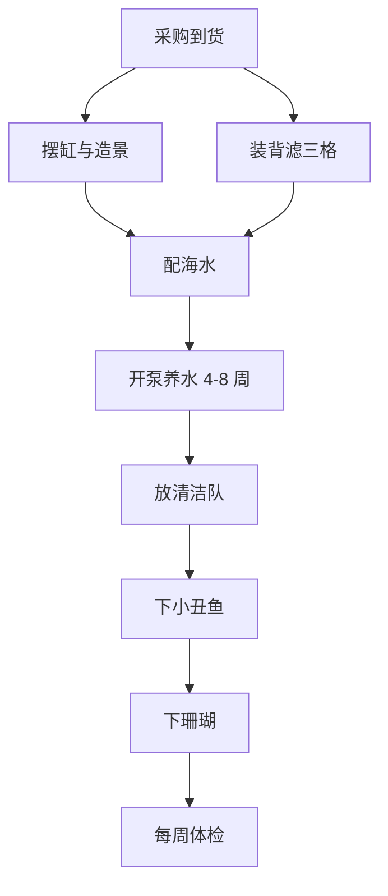

# 六维拆解总表（40cm 背滤海缸（小丑鱼练手版））

| 字段 | 值 |
|---|---|
| 适用版本 | v1.0 |
| 最后更新 | 2026-10-20 |
| 前置条件 | 读完 `00-总纲与路线图.md` |

## 1. 六维总表

| 维度 | 是什么 / 包含什么 | 买什么（MVP 部分） | 谁做 | 门槛（最难三步） | 降级路径 | 实现路径（件名 + 参数 + 谁做 + 多少钱 + 多久到） | 卡点 |
|---|---|---|---|---|---|---|---|
| ① 硬件电子 | 缸、泵、蛋分、造浪、灯、加热棒、两个插座、漏电保护 | 40 方背滤缸、600–1200L/h 泵、微缸蛋分、1500L/h 造浪、18W 夹灯、100W 加热棒、定时插座、温控插座、漏电保护 | 家长 L2（插电）／孩子 L1 | ① 背滤三格水位调对 ② 插座链路别漏漏电保护 ③ 蛋分不出泡时判断是水位问题 | 全部买成品，无焊接；不会挑就按 BOM 型号买 | 淘宝/拼多多现货，**4–7 天到**，￥848.9（26 项） | 蛋分水位、加热棒双保险 |
| ② 结构外壳 | 缸体摆放、缸垫、造景石、背滤格层 | EVA 缸垫 ￥12、人工造景石 2–3kg ￥35、造景胶 ￥15 | 孩子 L2（摆石头） | 摆出"不塌且有洞"的造景 | 不打印任何件也能开缸 | 可选打印件（防跳网框/灯夹）走嘉立创 3D 打印或淘宝代打，￥5–30/件、**3–7 天** | 石头塌、缸没垫 |
| ③ 固件 | 无 | 无 | — | — | — | **本项目不含单片机**；定时靠定时插座、恒温靠温控插座 | 误以为要编程 |
| ④ 上位机软件 | 无程序；只做数据记录 | 纸笔记录表（免费） | 孩子 L2（填表） | 连续记满 8 周不断档 | 手机备忘录代替打印表 | 记录模板 [`software/host/水质记录表.md`](../../software/host/水质记录表.md) | 记两周就断 |
| ⑤ 算法代码 | 无 | 无 | — | — | — | 可选：用表格软件把 `water_log.csv` 画折线 | 把它当成"要写代码的项目" |
| ⑥ 资料与生态 | 生物来源、养护知识、社区 | 人工小丑 ×2、清洁队、珊瑚断枝 ×3 | 家长 L2（下生物）／孩子 L1 | ① 选健康的人工繁殖鱼 ② 分批次入缸不一次下满 ③ 珊瑚安全操作 | 不会挑就找本地水族店现场看鱼 | 本地水族店/鱼友转让，￥220（首批），**随用随买** | 买野生鱼、一次下满 |

> 采购明细见 `05-安全与工具采购清单.md`；完整 BOM 见 [`hardware/bom/bom_nano40_v1.0.csv`](../../hardware/bom/bom_nano40_v1.0.csv)。

## 2. 依赖关系

关键路径：**养水（4–8 周）**——它是唯一不能压缩的一段，所有生物都在它后面排队。

## 3. 家长技能矩阵

| 技能 | 是否需要 | 用在哪 | 零基础替代 |
|---|---|---|---|
| 焊接 | **不需要** | — | 全部即插即用 |
| 烧录固件 | **不需要** | — | 无固件 |
| 命令行 | **不需要** | — | 用纸笔/表格软件 |
| 3D 打印 | 可选 | 防跳网框、灯夹 | 不打印也能开缸；或送代打 |
| 金属加工 | 不需要 | — | — |
| 配比与读数 | **必须** | 配海水、测盐度 | 按"1kg 盐 : 30L 水"和盐度计刻度做 |
| 耐心 | **必须**（无法替代） | 养水期 | 设"每 2 天测一次"的固定闹钟 |

## 4. Top 卡点清单

| # | 卡点 | 现象 | 预防手段 | 出现后先查什么 |
|---|---|---|---|---|
| 1 | 心急提前下鱼 | 鱼在水面喘气、很快死 | 立规矩：氨/亚硝酸盐**都归零**才买鱼 | 先测氨氮；立刻换水 30% |
| 2 | 蒸发后补了盐水 | 盐度一路涨到 1.030 | 补水**只加纯水**，专门一个补水桶 | 重新测盐度，分次加水稀释 |
| 3 | 蛋分不出泡 | 集污杯空、缸里水浑 | 先调背滤水位到刻度 | 水位 → 进气口是否堵 |
| 4 | 加热棒失控 | 水温超过 28℃ | 串一个温控插座做双保险 | 拔加热棒，用水温计复核 |
| 5 | 纽扣珊瑚操作不戴手套 | 手麻、发痒 | 手套与肥皂水常备缸边 | 用肥皂水彻底冲洗，不适就医 |

## 5. 与工程文档的对应关系

| 本手册章节 | 对应工程文档 |
|---|---|
| ① 硬件电子 | [`hardware/`](../../hardware/)（BOM + 布置图 + 插位表） |
| ② 结构外壳 | [`enclosure/`](../../enclosure/)（可选打印件） |
| ③ 固件 | [`firmware/README.md`](../../firmware/README.md)（说明为何无固件） |
| ④ 上位机软件 | [`software/host/`](../../software/host/)（记录模板） |
| ⑤ 算法代码 | [`code/README.md`](../../code/README.md)（说明为何无代码） |
| ⑥ 资料与生态 | [`docs/99-参考资源.md`](../99-参考资源.md) |
