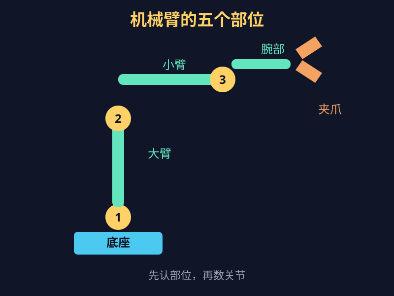
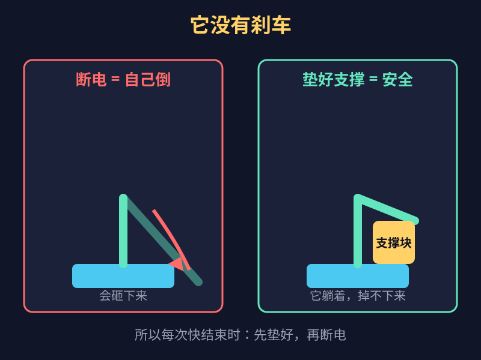
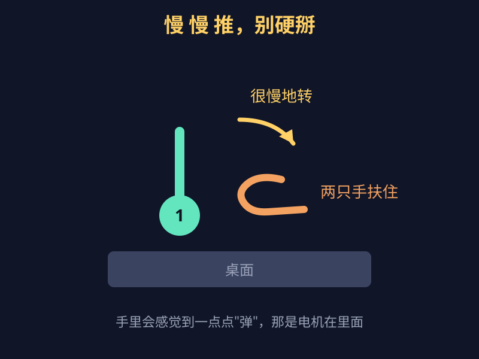

<!--
reBot-DevArm · 第 1 课课件
构建：python3 .trae/skills/stem-project-onboarding/scripts/build_slides.py projects/rebot-devarm/docs/儿童课程/第01课-认识我们的机械臂/课件.md
配图在 图/ 子目录，构建时自动内嵌进 HTML。
-->

<!-- layout: title -->
# 第 1 课 · 认识我们的机械臂

今天只做一件事：找出它的 7 个关节
<!-- notes: 开场 30 秒。只说今天要做的事，不讲原理。先问："你觉得它像什么？" -->

---
<!-- layout: image -->
## 先看一样东西

<!-- notes: 给孩子看 10 秒，问"你看到了什么"。不提示、不补充，让他自己说。 -->

---
<!-- layout: big -->
## 它有几个关节？
<!-- notes: 让孩子先猜一个数字。**不要说出答案**，下一页一起数。答错就说"那我们数数看"。 -->

---
<!-- layout: image -->
## 一起数：1 到 7

<!-- notes: 家长用手指点着数，孩子跟着念。数完再问一遍："刚才你猜的是几？" -->

---
<!-- layout: big -->
## 猜一猜：断电了它还站得住吗？
<!-- notes: 这是本课最重要的一问。让孩子先猜，再翻下一页给答案。 -->

---
<!-- layout: image -->
## 它没有刹车

<!-- notes: 用自行车打比方："没捏闸，坡上就会溜。"所以收工前一定要先垫好支撑，再断电。 -->

---
<!-- layout: image -->
## 动手 ③ 慢慢推
1. 扶住 1 号关节
2. 推过去、再推回来
3. 说"有点弹手"

<!-- notes: 强调"很慢"两个字。硬掰会损坏减速器。孩子做完问："手里那个弹弹的感觉，是什么？"（埋钩子，第 2 课回答） -->

---
<!-- layout: big -->
## 通关条件
能指着说出 7 个关节 = 过关
<!-- notes: 让孩子自己判定。家长不评价快慢，过关就盖章。 -->

---
<!-- layout: two-col -->
### 我们发现的
- 它一共有 7 个关节
- 推的时候手里有点弹
- 断电它会倒下来
### 记下的线索
- 第 7 个关节管的是夹爪
- 收工前要先垫支撑，再断电
<!-- notes: 收尾 3 问：今天成功的标志是什么 / 哪里最麻烦 / 下次想改哪里。把答案写进线索本。 -->

---
<!-- layout: title -->
# 恭喜过关
你现在是「观察员」了
<!-- notes: 盖章、发称号。预告第 2 课：把它装起来固定住（要拧螺丝了）。留一个钩子再下课。 -->
