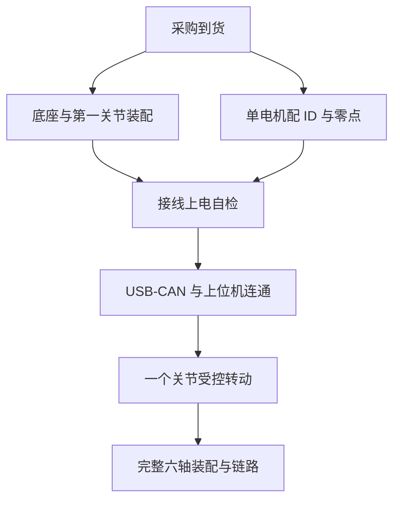

# 六维拆解总表（reBot-DevArm 开源六轴机械臂）

| 字段 | 值 |
|---|---|
| 适用版本 | 硬件 B601-DM v1.1（DC 24V）／软件 官方 LeRobot 链路（未实测） |
| 最后更新 | 2026-10-20 |
| 前置条件 | 读完 `00-总纲与路线图.md` |

## 1. 六维总表

| 维度 | 是什么 / 包含什么 | 买什么（MVP 部分） | 谁做 | 门槛（最难三步） | 降级路径（可外包/买成品） | 实现路径（买成品/代做/自制 + 参数） | 卡点 |
|---|---|---|---|---|---|---|---|
| ① 硬件电子 | 7 颗 CAN 总线关节电机（4× DM4310 V4 + 3× DM4340P V4）、24V 4.5A XT30 电源、CAN/电源线束、USB-CAN 适配器、终端电阻 | 1× DM4310 V4 电机 + USB-CAN 适配器 + 24V 4.5A XT30 电源 + 一套带端子的成品线束 | 家长 L2（接线上电）／孩子 L1（对号递件） | ① 认清 CAN-H/CAN-L 与 24V 正负，不接反；② 总线两端各接一个 120Ω 终端电阻；③ 给 USB-CAN 固定 udev 规则防设备名漂移 | 线束直接买成品（不压接）；USB-CAN 买"已带驱动与调试软件"的型号；**不需要焊接任何东西** | **买成品**：电机买达妙官方 DM4310 V4（单价待确认）；电源搜关键词 `24V 4.5A XT30`；USB-CAN 买常见型号（如 CANable / 达妙官方调试器，**型号待确认**） | 电源反接烧电机；总线缺终端电阻导致通信偶发失败；USB-CAN 驱动在 Ubuntu 上装不上 |
| ② 结构外壳 | 3D 打印件一批 + 金属加工件 30+ 件（CNC/钣金，阳极氧化）+ 热熔铜螺母 + 轴承 + 内六角螺丝多规格 | 只打**底座 + 第一关节**的打印件 + 对应螺丝与铜螺母（约 10–15 件） | 家长 L2（拧紧、控扭力）／孩子 L2（对件号、点数） | ① 螺丝规格相近件极多，混装必错；② 扭力必须 3–6 kgf·cm，超了滑丝报废；③ 铜螺母热熔温度与孔径 | 3D 打印找代打服务（按克计价）；金属件直接买**官方 Full Kit** 绕开全部加工 | **代做**：把官方 STEP 传给嘉立创 3D 打印 / 淘宝代打，材料承力件 PETG 或尼龙、填充 ≥40%、层高 0.2 mm、公差按 ±0.2 mm 留量；金属件 STEP + 铝合金 + 阳极氧化外协（约 ￥1500 量级，待确认） | 打印件公差导致装不上；v1.0 图纸配 v1.1 的 4340P 电机，第一关节装不上 |
| ③ 固件 | **本项目无自制主控板**：电机内部自带驱动与固件，参数（CAN ID、波特率、零点）用达妙上位机工具配置后写入电机 | 无（零固件采购项） | 家长 L3 / 孩子 L1（看现象） | ① 7 颗电机 CAN ID 不能冲突；② 波特率要与上位机一致（1 Mbps 常见，**待确认**）；③ 零点标定错了会一上电就撞限位 | 找卖家代配 ID 与零点（下单时问"能否按 ID 1–7 预配好"）；或先用官方调试软件在单电机上练手 | **配置而非编码**：装达妙官方调试工具 → 用 USB-CAN 接单颗电机 → 设 ID（1–7 不重复）、设波特率、标零点 → 写入保存 | 两颗电机同 ID → 整条总线通信混乱；零点标定后忘保存；调参工具认不到串口 |
| ④ 上位机软件 | Ubuntu **物理机** + Python 环境 + 官方 Python SDK / LeRobot 框架 + CAN 设备权限 | Ubuntu 物理机一台（可双系统）+ 官方 SDK | 家长 L2（照文档敲命令）／孩子 L1（看屏幕） | ① 官方明确**不支持虚拟机**，USB/CAN 直通与实时性都不行；② CAN 要用 `sudo` 或配 udev 权限，否则一直 "permission denied"；③ `/dev/ttyACM*` 顺序会漂移 | 环境装不上时找社区/卖家远程协助；或在 Windows 上用达妙调试软件先完成"单关节转动"这个 MVP | **照文档做**：Ubuntu 物理机 → 按官方 Wiki 装依赖 → 接 USB-CAN → 跑官方示例脚本让关节动 | 虚拟机跑不起来；CAN 权限；Ubuntu 版本与官方教程不匹配 |
| ⑤ 算法代码 | URDF/STL 模型包（`reBot_Arm_description/`，DM/RS 两版）、ros2_control / MoveIt / Pinocchio、Isaac Sim、LeRobot 数据集、GR00T N1.7 微调 | 无（MVP 不需要写代码）；可选官方 URDF 在 RViz 里可视化 | 家长 L3（只跑现成例子）／孩子 L1（看 3D 模型跟着鼠标转） | ① 训练链路需要 NVIDIA 显卡与算力；② LeRobot 数据集格式与版本变动快；③ VR 遥操作还需要一台 Quest 3 | **彻底降级**：不训练，只做"固定动作演示 + 示教回放"；可视化用 RViz 看 URDF 就足够让孩子兴奋 | **跑现成**：官方 URDF 在 RViz/MoveIt 里可视化（免费，无需真机）；进阶才上 Quest 3 + Isaac Lab + GR00T | 显卡不够；数据集版本不匹配；VR 遥操作延迟 |
| ⑥ 资料与生态 | 官方 GitHub/Gitee 仓库、Seeed Wiki 中文教程、58 分钟组装视频、社区踩坑帖、GR00T 微调指南、视觉抓取 Demo 仓库 | 无（网络资料） | 家长 L2（收藏与核对） | ① 官方仓库大（hardware/ 约 275 文件），不会只挑需要的；② 教程有中英两版且会更新，要认准日期；③ 链接失效风险 | 用 Gitee 镜像（国内更快）；关键图纸本地存档 | **归档**：克隆仓库或按需下载 `hardware/reBot_B601_DM/readme_zh.md` 与对应 STEP；把教程链接与访问日期登记进 `docs/99-参考资源.md` | 拿旧版教程配新版硬件；商用前没核许可（硬件 CERN-OHL-W-2.0 / 软件 Apache-2.0） |

> 采购明细与参考价见 `05-安全与工具采购清单.md`；打样/代做参数（层数、板厚、材料、填充、公差）与下单渠道见 skill 的 `references/可实现路径与外包.md`；工程参数以 `projects/rebot-devarm/docs/` 为准。

## 2. 依赖关系

关键路径：**采购（金属件与电机排期最长）→ 底座装配 → 通电 → 上位机连通**。最容易卡的是"上位机连通"这一段：它不是体力活，而是环境与权限问题，往往卡几天。

## 3. 家长技能矩阵（本项目实际需要）

| 技能 | 本项目是否需要 | 用在哪一步 | 零基础替代方案 |
|---|---|---|---|
| 焊接 | **不需要** | —（线束买成品带端子） | 全项目零焊接即可完成 MVP |
| 烧录固件 | **不需要**（改为"配置电机参数"） | 卡 M2-1 配 CAN ID 与零点 | 下单时请卖家按 ID 1–7 预配；先用官方调试软件在单电机上练手 |
| 命令行 | **需要（基础级）** | 卡 M3-1 装环境、跑官方示例 | 官方 Wiki 有逐条命令，复制粘贴即可；实在不行找远程协助 |
| 3D 打印 | 可选 | 卡 M1-1 底座打印件 | 直接找代打，传 STEP 文件按克计价 |
| 金属加工 | **不需要**（MVP 全部用打印件 + 成品） | —（完整六轴时才需要） | 买官方 Full Kit，避开 30+ 件金属加工 |
| 调试排错 | **必须**（无法外包） | 全程 | 按 `04-验收与展示.md` 的排查顺序做 |

> 结论：这个项目的**入门门槛比它看起来低**——不需要焊接、不需要写代码、不需要自制电路板。真正的门槛是"拧螺丝的耐心"和"装 Linux 环境的细心"。

## 4. Top 卡点清单（提前预防）

| # | 卡点 | 现象 | 预防手段 | 出现后先查什么 |
|---|---|---|---|---|
| 1 | 电源极性接反 / 电压不对 | 一上电电机发烫、冒烟或毫无反应 | 上电前用万用表量输出，确认 24V 直流且正负与线束标注一致；用 XT30 防反插接头 | 立即断电 → 量电源输出 → 量电机端电压 → 检查线束颜色与端子方向 |
| 2 | CAN 总线终端电阻缺失 | 单电机能通信，接上第二颗就开始偶发掉线 | 总线**两端**各装一个 120Ω 终端电阻（总线式拓扑，不能星形分叉） | 查两端电阻 → 缩短线 → 远离电源大电流线 → 确认共地 |
| 3 | 螺丝滑丝、部件报废 | 拧不动还硬拧，螺牙磨平 | 电批扭力调到 3–6 kgf·cm，螺丝先按规格分装；拧不动就退出来重新对孔 | 换一颗同规格螺丝 + 铜螺母；已滑丝的孔改用大一号铜螺母重熔 |
| 4 | 无刹车导致断电下落 | 断电瞬间臂体快速砸下，压坏件或压手 | 调试全程用支撑座托住臂体；程序里不允许"断电即安全"的假设 | 先断电 → 手动托稳 → 再处理；检查是否有件被压变形 |
| 5 | Ubuntu 里 CAN 权限不足 | 跑脚本报 `permission denied` 或找不到设备 | 先按官方文档配 udev 规则固定设备名与权限（比每次 `sudo` 更稳） | `ls /dev/ttyACM*` 看设备是否存在 → 查 udev 规则 → 查用户是否在 `dialout` 组 |
| 6 | 用虚拟机做上位机 | Demo 跑不起来、延迟大、设备时有时无 | 官方明确不支持虚拟机，**直接上物理机（双系统也可）** | 换成物理机重试；不要在虚拟机上继续排错，浪费时间 |

## 5. 与工程文档的对应关系

| 本手册章节 | 对应工程文档 |
|---|---|
| ① 硬件电子 | `projects/rebot-devarm/hardware/`（BOM 草稿：`hardware/bom/bom_b601-dm_v1.1-draft.csv`） |
| ② 结构外壳 | `projects/rebot-devarm/enclosure/`（打印与装配：`enclosure/print-notes.md`） |
| ③ 固件 | `projects/rebot-devarm/firmware/`（本项目为电机内置固件 + 参数配置） |
| ④ 上位机软件 | `projects/rebot-devarm/software/` |
| ⑤ 算法代码 | `projects/rebot-devarm/code/` |
| ⑥ 资料与生态 | `projects/rebot-devarm/docs/99-参考资源.md` |
