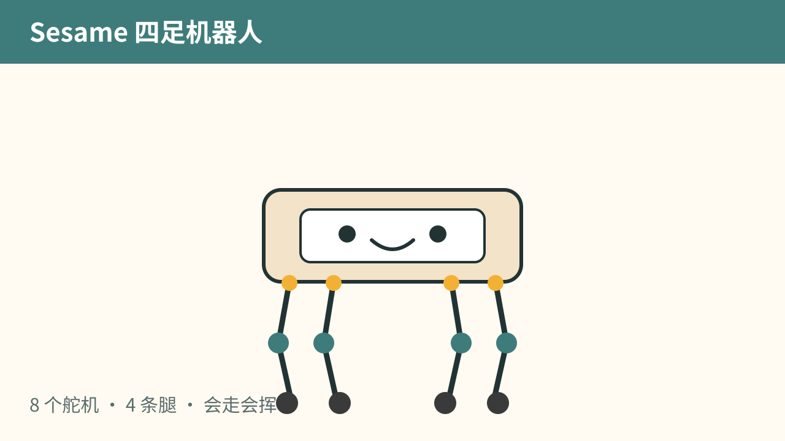

# 知识卡 · 四足机器人（代号贴纸：K05-01）

> 打印建议：A5 横向 / 一页两卡对折；正面给孩子看（大字 + 图），背面给家长看（怎么问、线索记录）。

## 正面（给孩子看）

### ① 看到什么

四条腿的机器，推一下也不容易倒。

### ② 先猜

它为什么比两条腿的机器人更稳？

- A. 腿多，支撑点更多
- B. 腿多，跑得更快

<!-- 不写答案，留白。家长在背面第 ② 步准备接话。 -->

### ③ 动手验证（家里就能做，5 分钟）

1. 拿 4 支铅笔和橡皮筋，扎成一个四脚小架子。
2. 把它放在桌上，用手指轻轻推一侧。
3. 再拿 2 支笔做一个两脚架，推一下，比一比谁先倒。

### ④ 它叫什么

- 外号：四条腿的桌子
- 正式名：**四足机器人**
- 一句话：四条腿轮流撑地，所以站得稳。

### ⑤ 还在哪见过

- 家里：家里的桌子、椅子
- 外面：工地上的四足巡检机器人

---

## 背面（给家长看）

| 项 | 内容 |
|---|---|
| 这张卡想让孩子明白 | 腿多 → 支撑点多 → 更稳；不是腿多就跑得快。 |
| ② 的引导 | 等 10 秒再提示；孩子说“跑得快”也没关系，让实验说话。 |
| ③ 的预期结果 | 四脚架被推后只晃一下；两脚架容易倒。看不到时先检查橡皮筋有没有扎紧。 |
| 适合档位 | L1 说现象 / L2 换推的力度再试 / L3 讲给家人听 |
| 常见误解 | 容易以为腿越多越厉害；实际是支撑更稳，但控制更难。 |
| 延伸追问 | 1）四足机器人走路时几条腿着地？ 2）为什么机器人不用轮子？ 3）你在哪里见过四足机器人？ |
| 线索记录 | 日期：＿＿＿＿ ／ 现象：＿＿＿＿ ／ 结论：＿＿＿＿ |

> 集卡规则：本卡盖 1 枚章；集满同一称号的 3 张卡，发称号「观察员」，贴纸贴在卡片右上角代号处。
