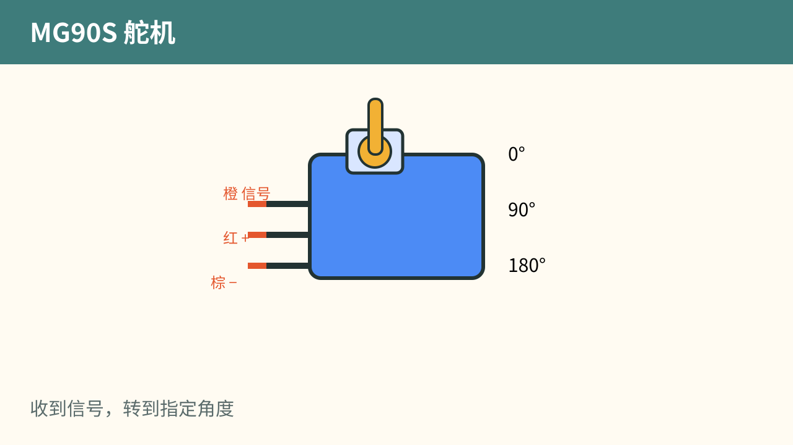

# 知识卡 · 舵机（代号贴纸：K05-02）

> 打印建议：A5 横向 / 一页两卡对折；正面给孩子看（大字 + 图），背面给家长看（怎么问、线索记录）。

## 正面（给孩子看）

### ① 看到什么

让它转到 90°，它就停在 90° 不动。

### ② 先猜

舵机和普通小马达，最大的不同是什么？

- A. 它能停在指定角度
- B. 它转得更快

<!-- 不写答案，留白。家长在背面第 ② 步准备接话。 -->

### ③ 动手验证（家里就能做，5 分钟）

1. 在纸盘上写 0、90、180 三个刻度。
2. 用回形针做一个指针，插在纸盘中心。
3. 用手把指针转到 90°，停住 3 秒，再转到 180°。

### ④ 它叫什么

- 外号：会数角度的胳膊
- 正式名：**舵机**
- 一句话：收到信号，转到指定角度并停住。

### ⑤ 还在哪见过

- 家里：遥控玩具车的转向
- 外面：无人机机翼、机器人关节

---

## 背面（给家长看）

| 项 | 内容 |
|---|---|
| 这张卡想让孩子明白 | 舵机 = 角度可控；普通马达 = 一直转。 |
| ② 的引导 | 让孩子先摸一摸舵机实物；没有实物就用纸盘指针代替。 |
| ③ 的预期结果 | 指针能停在 90° 并保持；如果手一松就转回去，说明缺少“保持力”，正好对比舵机。 |
| 适合档位 | L1 说现象 / L2 停在 45° 再试 / L3 讲“角度”和“一直转”的区别 |
| 常见误解 | 容易把舵机当成普通马达；舵机内部会对照目标角度。 |
| 延伸追问 | 1）舵机为什么不用一直转？ 2）0°、90°、180° 分别像身体的什么姿势？ 3）舵机没电时还能保持角度吗？ |
| 线索记录 | 日期：＿＿＿＿ ／ 现象：＿＿＿＿ ／ 结论：＿＿＿＿ |

> 集卡规则：本卡盖 1 枚章；集满同一称号的 3 张卡，发称号「机械师」，贴纸贴在卡片右上角代号处。
