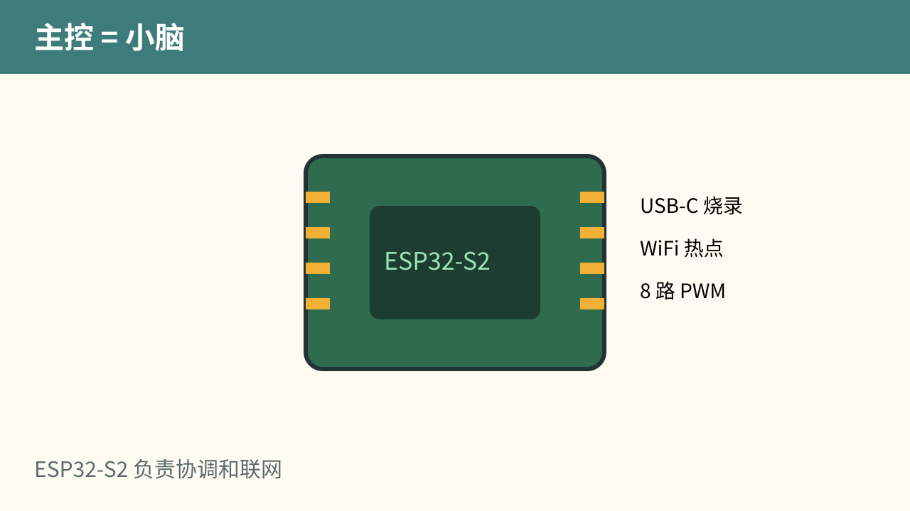

# 知识卡 · 主控与固件（代号贴纸：K05-03）

> 打印建议：A5 横向 / 一页两卡对折；正面给孩子看（大字 + 图），背面给家长看（怎么问、线索记录）。

## 正面（给孩子看）

### ① 看到什么

一个“大脑”把命令分给 8 个关节。

### ② 先猜

8 个舵机同时收到命令，会不会乱？

- A. 不会，主控按编号依次发
- B. 会，谁快听谁的

<!-- 不写答案，留白。家长在背面第 ② 步准备接话。 -->

### ③ 动手验证（家里就能做，5 分钟）

1. 写 8 张纸条，分别标 S0–S7，分给 8 个家人或摆 8 个玩具。
2. 家长喊“S3”，只有拿 S3 的人举牌。
3. 再喊一串“S0、S1、S2”，看是不是按顺序动。

### ④ 它叫什么

- 外号：发作业的班长
- 正式名：**主控**
- 一句话：按编号把命令分给每个关节。

### ⑤ 还在哪见过

- 家里：电视遥控器
- 外面：交通灯控制器

---

## 背面（给家长看）

| 项 | 内容 |
|---|---|
| 这张卡想让孩子明白 | 主控 = 分发命令；固件 = 主控里的小脑程序。 |
| ② 的引导 | 先玩“喊编号”游戏，再回到机器人；不要先讲程序。 |
| ③ 的预期结果 | 只有被喊到编号的人举牌；喊错编号就没人动，正好说明编号要对应。 |
| 适合档位 | L1 举牌 / L2 自己喊编号 / L3 解释“固件是写在主控里的规则” |
| 常见误解 | 容易以为主控自己会走路；它只发命令，真正动的是舵机。 |
| 延伸追问 | 1）如果没有主控，8 个舵机会怎样？ 2）固件烧坏了还能动吗？ 3）主控怎么知道该发给谁？ |
| 线索记录 | 日期：＿＿＿＿ ／ 现象：＿＿＿＿ ／ 结论：＿＿＿＿ |

> 集卡规则：本卡盖 1 枚章；集满同一称号的 3 张卡，发称号「观察员」，贴纸贴在卡片右上角代号处。
