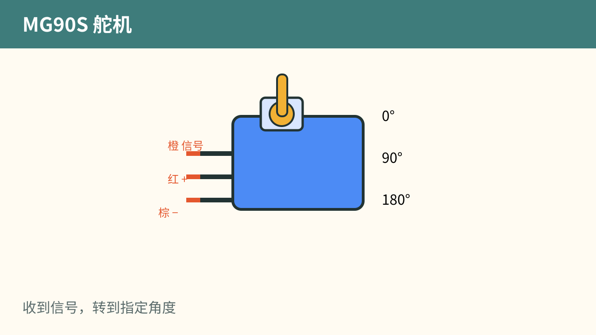

# 知识卡 · PWM（代号贴纸：K05-16）

> 打印建议：A5 横向 / 一页两卡对折；正面给孩子看（大字 + 图），背面给家长看（怎么问、线索记录）。

## 正面（给孩子看）

### ① 看到什么

灯快速开关，看起来却是一半亮。

### ② 先猜

开关得足够快，眼睛会看到什么？

- A. 一直亮着（亮度变了）
- B. 一闪一闪很明显

<!-- 不写答案，留白。家长在背面第 ② 步准备接话。 -->

### ③ 动手验证（家里就能做，5 分钟）

1. 拿一个手电或手机灯，对着白墙。
2. 快速按开关：亮 1 秒、灭 1 秒，记住亮度。
3. 再试亮 0.1 秒、灭 0.1 秒，看亮度有没有变化。

### ④ 它叫什么

- 外号：敲桌子的节拍
- 正式名：**PWM**
- 一句话：用开关的快慢和比例控制大小。

### ⑤ 还在哪见过

- 家里：调光台灯、风扇调速
- 外面：LED 调光、电机调速

---

## 背面（给家长看）

| 项 | 内容 |
|---|---|
| 这张卡想让孩子明白 | PWM = 快速开关；亮的时间占比越大，效果越强。 |
| ② 的引导 | 只用手电/手机灯，不碰 220V；强调“快到眼睛看不出来”。 |
| ③ 的预期结果 | 快速开关时看起来更暗/更亮，而不是明显闪烁。 |
| 适合档位 | L1 看亮度 / L2 改快慢再试 / L3 说“占空比”像什么 |
| 常见误解 | 容易以为 PWM 是“调电压”；它其实是快速开关。 |
| 延伸追问 | 1）舵机为什么用 PWM？ 2）开关太慢会怎样？ 3）风扇调速和调光有什么共同点？ |
| 线索记录 | 日期：＿＿＿＿ ／ 现象：＿＿＿＿ ／ 结论：＿＿＿＿ |

> 集卡规则：本卡盖 1 枚章；集满同一称号的 3 张卡，发称号「机械师」，贴纸贴在卡片右上角代号处。
