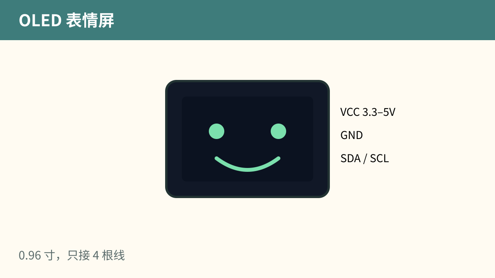

# 知识卡 · I2C（代号贴纸：K05-17）

> 打印建议：A5 横向 / 一页两卡对折；正面给孩子看（大字 + 图），背面给家长看（怎么问、线索记录）。

## 正面（给孩子看）

### ① 看到什么

屏幕只用两根线就能和主控说话。

### ② 先猜

两根线怎么分得清“发”和“收”？

- A. 一根发时钟，一根传数据
- B. 两根线都随便传

<!-- 不写答案，留白。家长在背面第 ② 步准备接话。 -->

### ③ 动手验证（家里就能做，5 分钟）

1. 两个人玩“对讲机”：一人当主控，一人当屏幕。
2. 第一根绳子只用来打节拍（拍手），第二根用来传纸条。
3. 换过来试试：没有节拍，纸条还能不能按顺序读？

### ④ 它叫什么

- 外号：两根线的对讲机
- 正式名：**I2C**
- 一句话：一根打节拍，一根传数据。

### ⑤ 还在哪见过

- 家里：耳机线、充电线
- 外面：屏幕、传感器模块

---

## 背面（给家长看）

| 项 | 内容 |
|---|---|
| 这张卡想让孩子明白 | I2C 用 SDA/SCL 两根线：一根数据，一根时钟。 |
| ② 的引导 | 用“拍手打节拍 + 传纸条”演示；不要讲地址和时序。 |
| ③ 的预期结果 | 有节拍时纸条能按顺序读；没有节拍时容易乱。 |
| 适合档位 | L1 玩对讲机 / L2 指认 SDA/SCL / L3 说为什么只要两根线 |
| 常见误解 | 容易把 SDA 和 SCL 接反；接反屏幕就不亮。 |
| 延伸追问 | 1）SDA 和 SCL 分别是什么？ 2）为什么 I2C 能接多个设备？ 3）屏幕不亮先查哪两根线？ |
| 线索记录 | 日期：＿＿＿＿ ／ 现象：＿＿＿＿ ／ 结论：＿＿＿＿ |

> 集卡规则：本卡盖 1 枚章；集满同一称号的 3 张卡，发称号「观察员」，贴纸贴在卡片右上角代号处。
