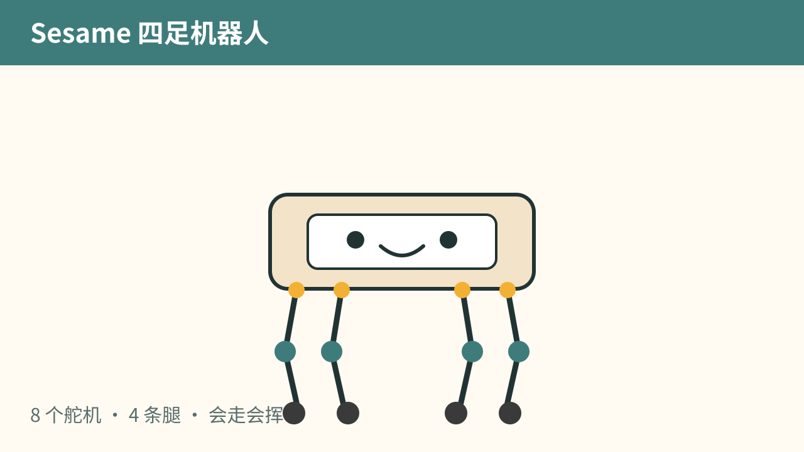
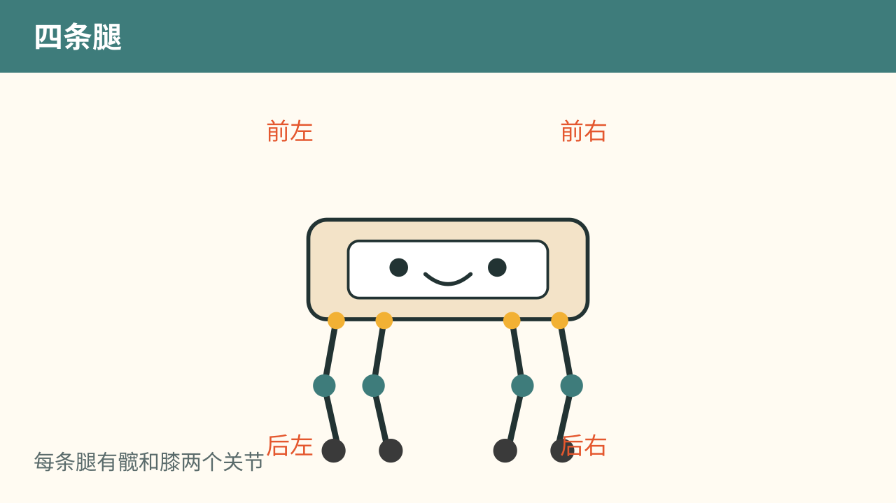
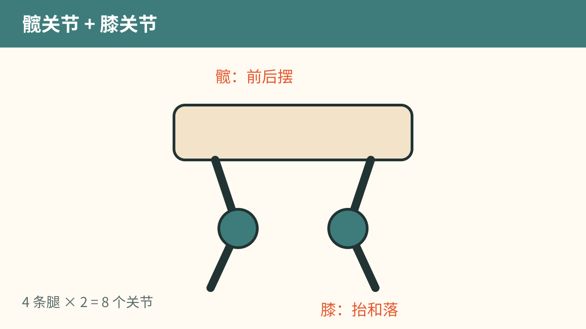
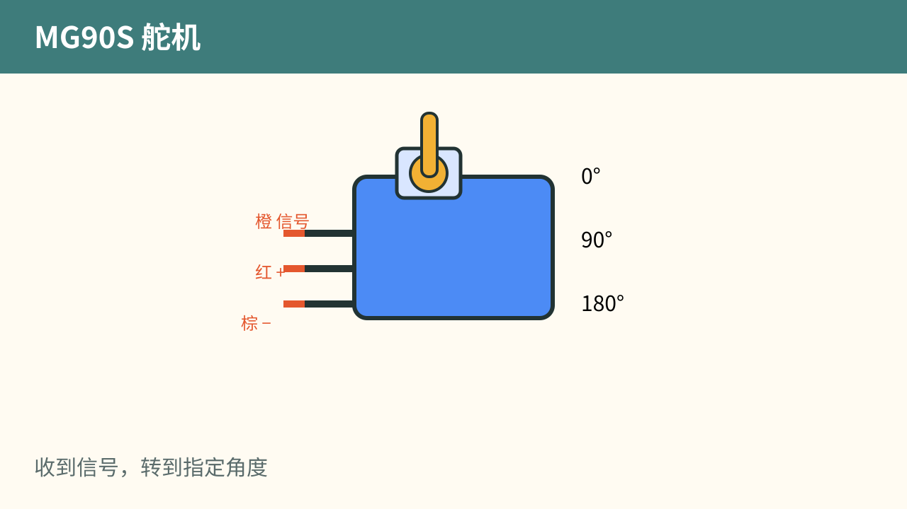
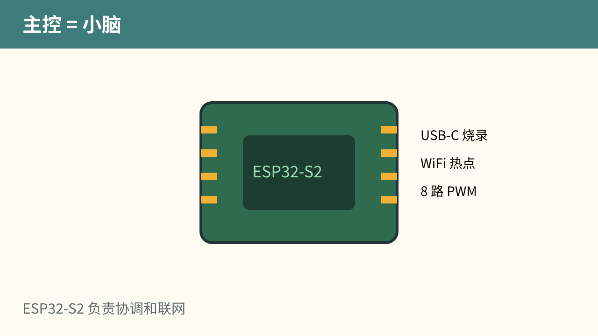
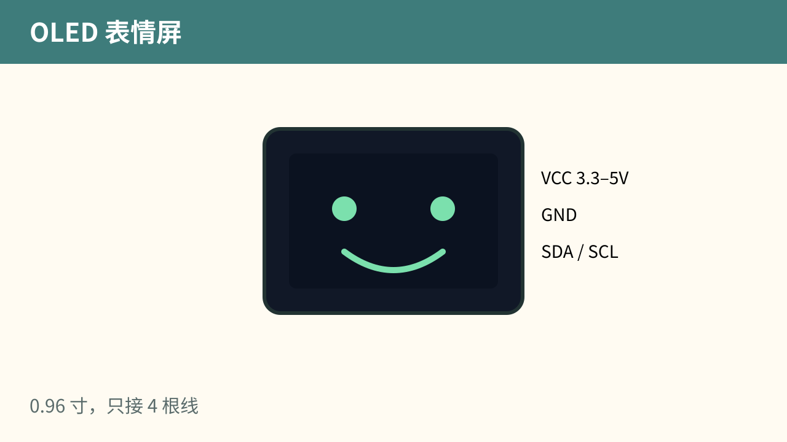
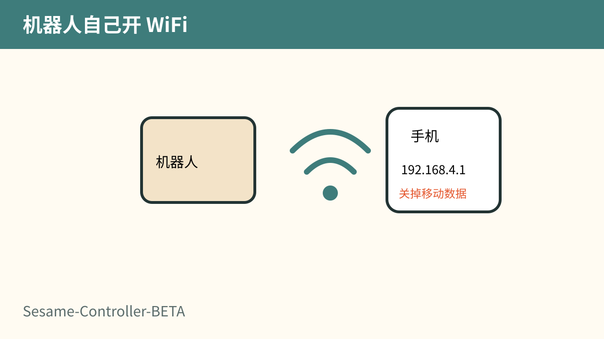
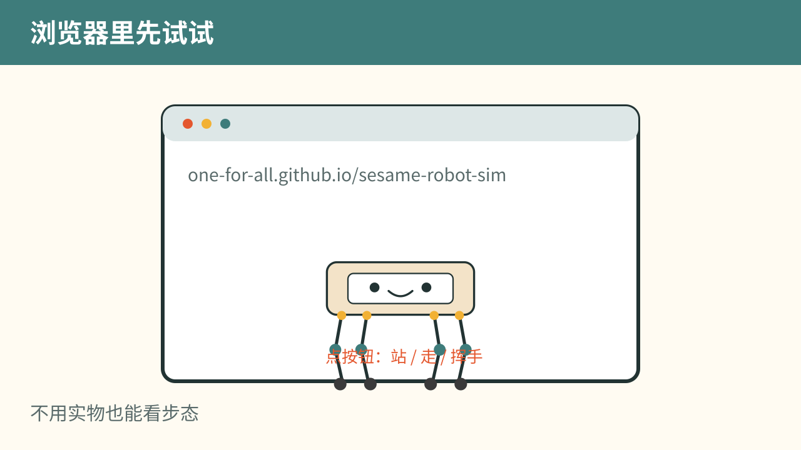

<!-- Sesame Robot 儿童课件 · 第第0课；每页含图位与讲者备注 -->

<!-- layout: title -->
# Sesame Robot · 第 1 课

今天先看，不动手
<!-- notes: 开场 30 秒，只说今天要做的事：认识这台四条腿的小机器。 -->

---
<!-- layout: image -->
## 它有几条腿？

<!-- notes: 给孩子看 10 秒，问"你看到了什么"，不提示、不补充。 -->

---
<!-- layout: big -->
## 猜一猜
它走路时几条腿同时动？
<!-- notes: 让孩子先猜再往下看。答案不写在页面上；答错就说"那我们看看"。 -->

---
<!-- layout: image -->
## 每条腿两个关节

<!-- notes: 指着图说：髋管前后摆，膝管抬和落；4 条腿 ×2 = 8 个关节。 -->

---
<!-- layout: image -->
## 关节里是谁在动？

<!-- notes: 拿出一个 MG90S 实物对照；强调它"会数角度"，不是一直转的普通电机。 -->

---
<!-- layout: image -->
## 背上的小脑

<!-- notes: 主控负责把命令分给 8 个舵机，还负责开 WiFi；不展开原理。 -->

---
<!-- layout: image -->
## 会做表情的眼睛

<!-- notes: 让孩子说出屏幕上的表情；只说"它用 4 根线跟主控说话"。 -->

---
<!-- layout: image -->
## 它自己开 WiFi

<!-- notes: 强调连上后手机要关移动数据；这是后面所有课都会用到的入口。 -->

---
<!-- layout: image -->
## 先在仿真里试试

<!-- notes: 打开仿真页，点"走"和"挥手"，让孩子指出哪条腿在动。 -->

---
<!-- layout: two-col -->
### 我们发现的
- 4 条腿
- 8 个舵机
### 记下的线索
- 舵机 = 会数角度的电机
<!-- notes: 收尾 3 问：今天成功的标志是什么 / 哪里最麻烦 / 下次想改哪里。 -->

---
<!-- layout: title -->
# 恭喜过关
你是「观察员」
<!-- notes: 发知识卡 01/02/03/16/17，预告下一课：把四条腿真正装出来。 -->
