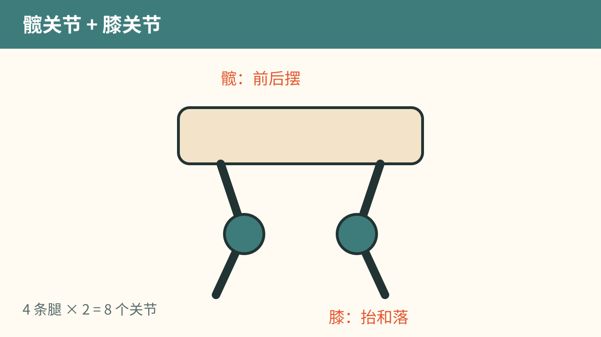

# 知识卡 · 关节（代号贴纸：K05-04）

> 打印建议：A5 横向 / 一页两卡对折；正面给孩子看（大字 + 图），背面给家长看（怎么问、线索记录）。

## 正面（给孩子看）

### ① 看到什么

一条腿弯一下，只有一个地方在转。

### ② 先猜

一条腿要抬起来，需要几个关节？

- A. 两个：髋和膝
- B. 一个就够了

<!-- 不写答案，留白。家长在背面第 ② 步准备接话。 -->

### ③ 动手验证（家里就能做，5 分钟）

1. 拿两根筷子和一个图钉，在筷子一头扎一个孔。
2. 用图钉把两根筷子连起来，做成一个“铰链”。
3. 捏住一根筷子，转另一根，观察它只能绕一个点转。

### ④ 它叫什么

- 外号：门的合页
- 正式名：**关节**
- 一句话：两段结构绕一个点转动。

### ⑤ 还在哪见过

- 家里：门合页、剪刀
- 外面：挖掘机的机械臂

---

## 背面（给家长看）

| 项 | 内容 |
|---|---|
| 这张卡想让孩子明白 | 每条腿两个关节：髋管前后，膝管抬落。 |
| ② 的引导 | 让孩子先找家里的合页/剪刀，再指机器人腿上的两个关节。 |
| ③ 的预期结果 | 筷子只能绕图钉转，不能上下折；说明一个关节只有一个转轴。 |
| 适合档位 | L1 指关节 / L2 数两条腿共几个关节 / L3 讲髋和膝的分工 |
| 常见误解 | 容易以为关节越多越难；关节多才能做更多动作，但要配合。 |
| 延伸追问 | 1）人腿有几个主要关节？ 2）为什么每条腿要两个而不是一个？ 3）关节装反了会怎样？ |
| 线索记录 | 日期：＿＿＿＿ ／ 现象：＿＿＿＿ ／ 结论：＿＿＿＿ |

> 集卡规则：本卡盖 1 枚章；集满同一称号的 3 张卡，发称号「机械师」，贴纸贴在卡片右上角代号处。
