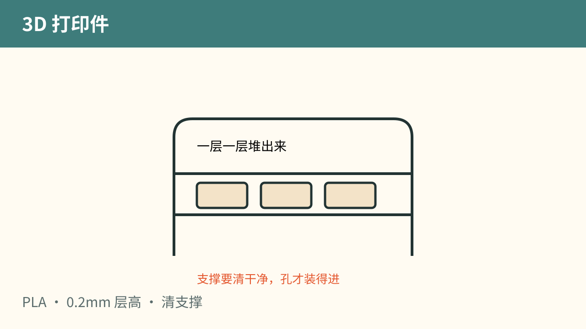

# 知识卡 · 3D 打印件（代号贴纸：K05-05）

> 打印建议：A5 横向 / 一页两卡对折；正面给孩子看（大字 + 图），背面给家长看（怎么问、线索记录）。

## 正面（给孩子看）

### ① 看到什么

打印件上有一圈一圈的细纹。

### ② 先猜

这些纹路是怎么来的？

- A. 一层一层堆出来的
- B. 用刀刻出来的

<!-- 不写答案，留白。家长在背面第 ② 步准备接话。 -->

### ③ 动手验证（家里就能做，5 分钟）

1. 拿 5–8 张纸，一层一层叠起来。
2. 从侧面看，能数出一层一层的边。
3. 用橡皮泥捏一个方块，再用尺子压出横纹，对比两种“层”。

### ④ 它叫什么

- 外号：一层层叠的蛋糕
- 正式名：**3D 打印**
- 一句话：把材料一层层堆成形状。

### ⑤ 还在哪见过

- 家里：蛋糕的层、千层饼
- 外面：打印店里的 3D 打印机

---

## 背面（给家长看）

| 项 | 内容 |
|---|---|
| 这张卡想让孩子明白 | 打印 = 分层堆叠；层高越小越细，但更慢。 |
| ② 的引导 | 不要讲喷嘴温度；只说“一层层堆”，让孩子看侧面纹路。 |
| ③ 的预期结果 | 纸叠侧面有清晰的层；橡皮泥压出的横纹也能看到。 |
| 适合档位 | L1 数层数 / L2 比较厚纸和薄纸 / L3 说“层高”影响什么 |
| 常见误解 | 容易以为打印件是“倒出来的”；实际是一层层堆的。 |
| 延伸追问 | 1）为什么打印件会有支撑？ 2）层高小一点会怎样？ 3）打印件为什么不能太用力拧螺丝？ |
| 线索记录 | 日期：＿＿＿＿ ／ 现象：＿＿＿＿ ／ 结论：＿＿＿＿ |

> 集卡规则：本卡盖 1 枚章；集满同一称号的 3 张卡，发称号「机械师」，贴纸贴在卡片右上角代号处。
