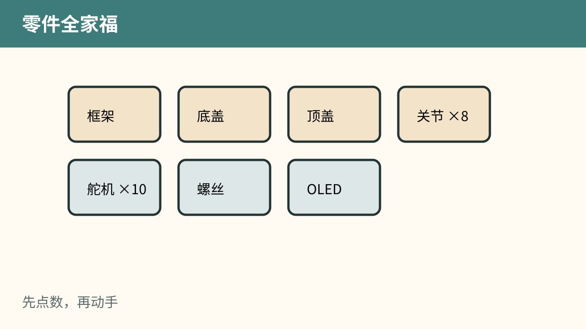
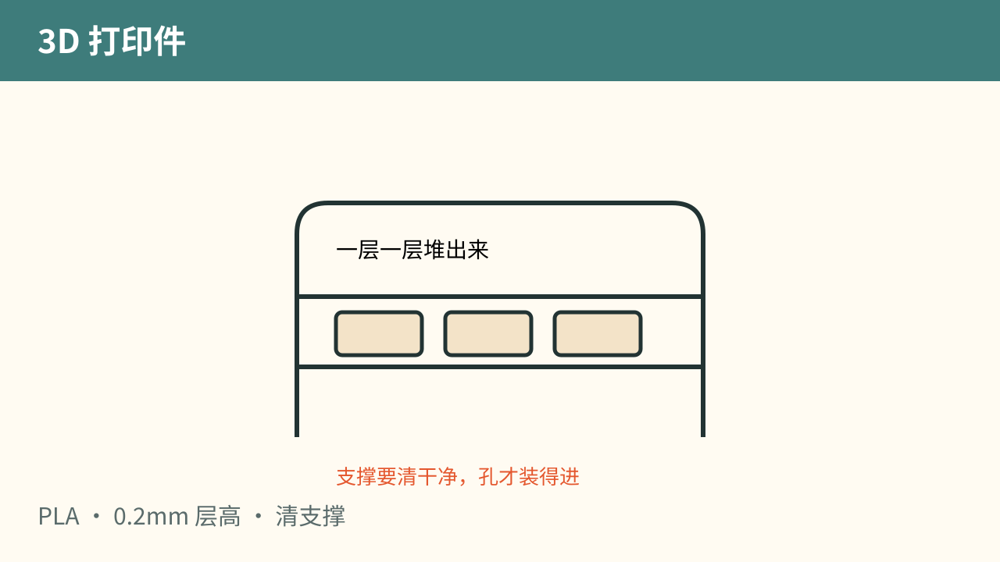
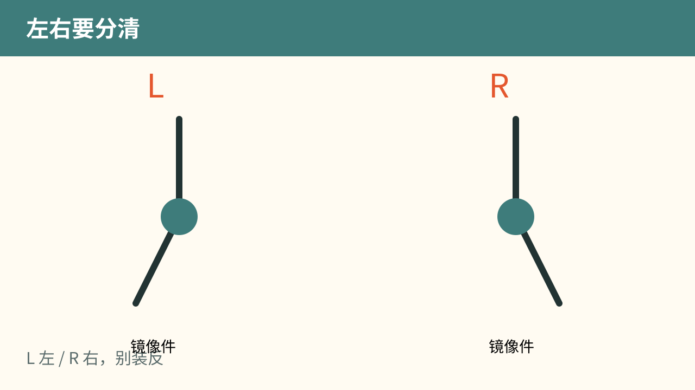
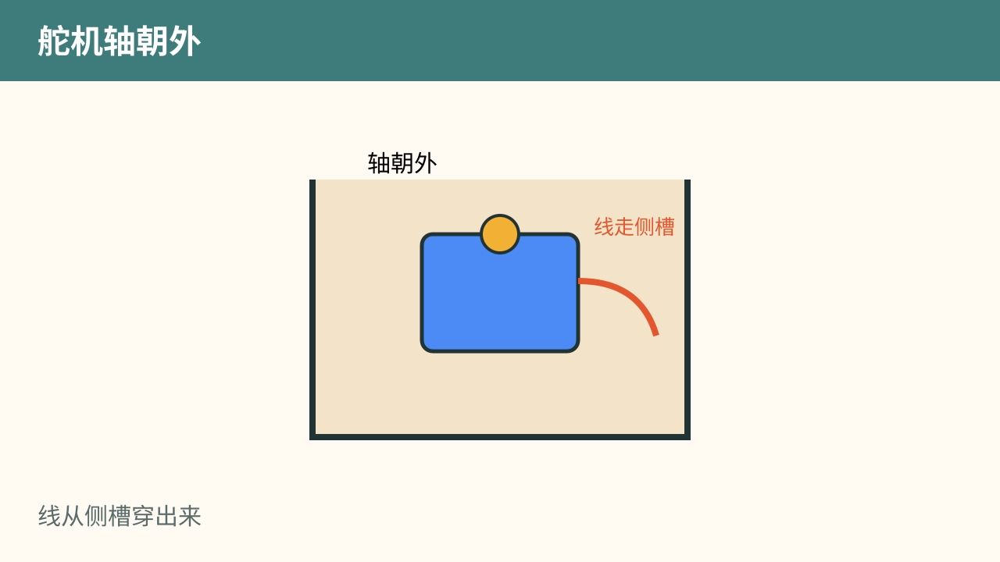
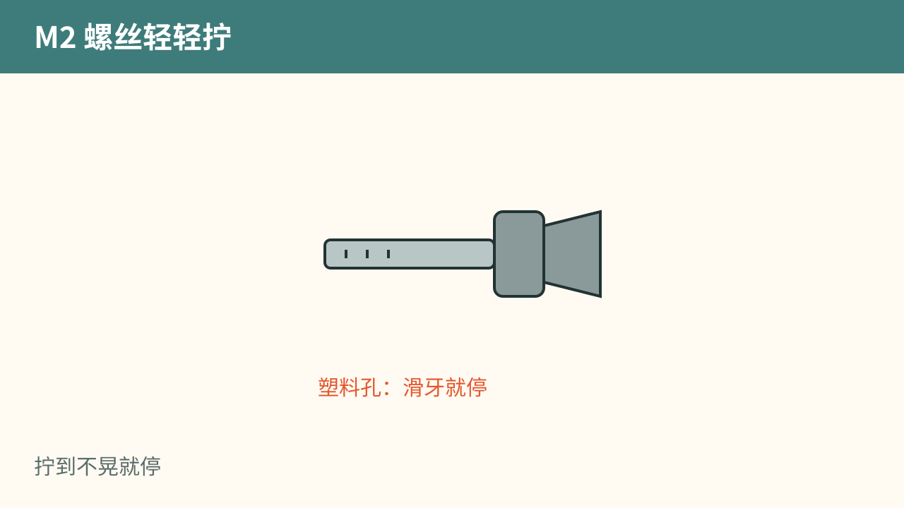
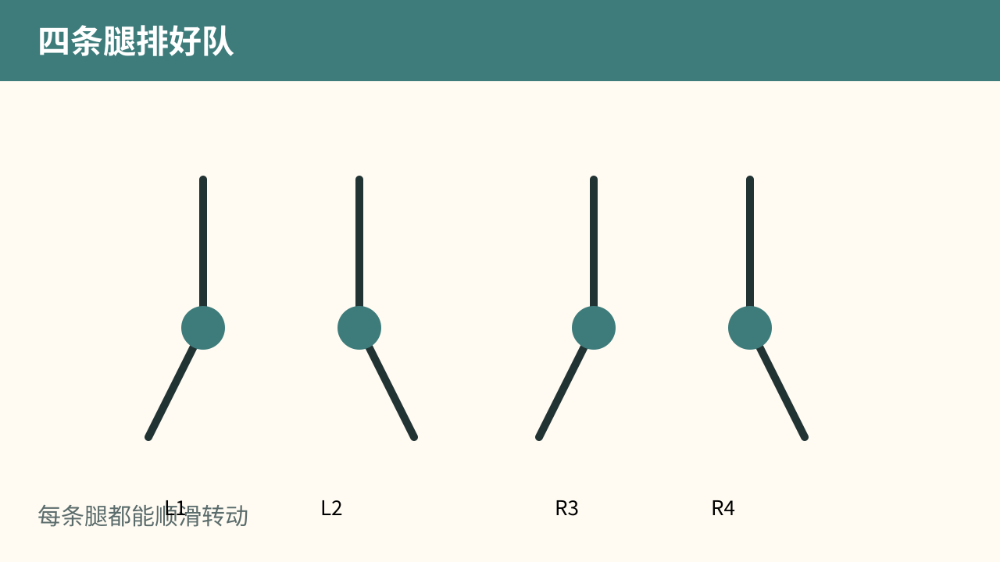

<!-- Sesame Robot 儿童课件 · 第第0课；每页含图位与讲者备注 -->

<!-- layout: title -->
# Sesame Robot · 第 2 课

今天：把四条腿装出来
<!-- notes: 开场先看零件全家福，告诉孩子今天只做"装腿"，不接线、不通电。 -->

---
<!-- layout: image -->
## 先点数

<!-- notes: 11 个打印件 + 10 个舵机 + 螺丝，逐项点数；缺件先记下。 -->

---
<!-- layout: image -->
## 11 个打印件

<!-- notes: 框架 1、上下盖各 1、关节 8；让孩子先清支撑，再按 L/R 分堆。 -->

---
<!-- layout: image -->
## 左右要分清

<!-- notes: 镜像件长得像但装法相反；贴 L/R 标签，装反了后面走路会歪。 -->

---
<!-- layout: big -->
## 猜一猜
舵机轴朝哪边？
<!-- notes: 让孩子先指方向再动手；答错不纠正，装的时候自己会发现。 -->

---
<!-- layout: image -->
## 轴朝外，线走槽

<!-- notes: 舵机轴朝壳体外面，线从侧槽穿出；不要压线，不要暴力塞。 -->

---
<!-- layout: image -->
## 螺丝轻轻拧

<!-- notes: M2 自攻螺丝拧到不晃就停；塑料孔滑牙就停，不能靠蛮力。 -->

---
<!-- layout: image -->
## 四条腿排好队

<!-- notes: 每装好一条腿，手动转一下关节，确认顺滑、不夹线。 -->

---
<!-- layout: big -->
## 通关条件
4 条腿都不晃
<!-- notes: 让孩子自己晃一晃验收；过关盖章，称号「装配员」。 -->

---
<!-- layout: two-col -->
### 我们发现的
- 左腿和右腿是镜像
- 螺丝不能硬拧
### 记下的线索
- 舵机轴朝外
<!-- notes: 收尾 3 问；提醒下一课要接线，危险步骤由家长做。 -->

---
<!-- layout: title -->
# 恭喜过关
你是「装配员」
<!-- notes: 发知识卡 04/05，预告下一课：电源、信号线和屏幕。 -->
