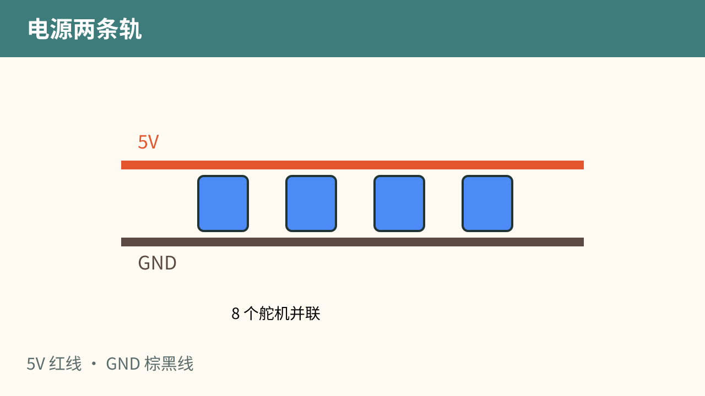

# 知识卡 · 电压与电流（代号贴纸：K05-06）

> 打印建议：A5 横向 / 一页两卡对折；正面给孩子看（大字 + 图），背面给家长看（怎么问、线索记录）。

## 正面（给孩子看）

### ① 看到什么

电池的电有“压力”，也有“流量”。

### ② 先猜

电压和电流，哪个像水压，哪个像水流？

- A. 电压像水压，电流像水流
- B. 反过来

<!-- 不写答案，留白。家长在背面第 ② 步准备接话。 -->

### ③ 动手验证（家里就能做，5 分钟）

1. 准备两个水杯，一个举高，一个放低。
2. 用一根吸管把两杯连起来，看水往哪边流。
3. 把高杯子再举高一点，看水流是不是更快。

### ④ 它叫什么

- 外号：水压与水龙头
- 正式名：**电压 / 电流**
- 一句话：电压是压力，电流是流量。

### ⑤ 还在哪见过

- 家里：水龙头开大开小
- 外面：充电器上的 5V/3A 标注

---

## 背面（给家长看）

| 项 | 内容 |
|---|---|
| 这张卡想让孩子明白 | 5V 是“压力”，3A 是“最多能流多少”。 |
| ② 的引导 | 只用两杯水和吸管，不要碰插座；讲完立刻把水倒掉。 |
| ③ 的预期结果 | 水从高处流向低处；举得越高，流得越快。 |
| 适合档位 | L1 看水流方向 / L2 改高度再试 / L3 对应 5V/3A 标签 |
| 常见误解 | 容易把 V 和 A 混为一谈；V 是压力，A 是流量。 |
| 延伸追问 | 1）为什么充电头要 5V/3A？ 2）水压太高会怎样？ 3）电池的 7.4V 和舵机的 5V 一样吗？ |
| 线索记录 | 日期：＿＿＿＿ ／ 现象：＿＿＿＿ ／ 结论：＿＿＿＿ |

> 集卡规则：本卡盖 1 枚章；集满同一称号的 3 张卡，发称号「信号员」，贴纸贴在卡片右上角代号处。
