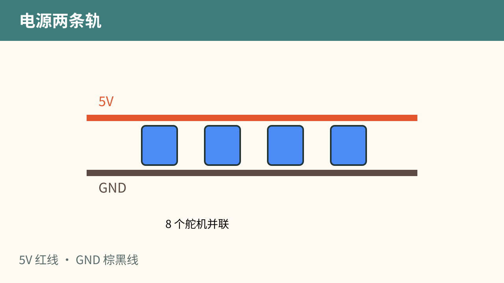

# 知识卡 · 降压模块（代号贴纸：K05-07）

> 打印建议：A5 横向 / 一页两卡对折；正面给孩子看（大字 + 图），背面给家长看（怎么问、线索记录）。

## 正面（给孩子看）

### ① 看到什么

电池 7.4V，舵机只要 5V。

### ② 先猜

多出来的电压去哪了？

- A. 被降压模块“减掉”了
- B. 被舵机吃掉了

<!-- 不写答案，留白。家长在背面第 ② 步准备接话。 -->

### ③ 动手验证（家里就能做，5 分钟）

1. 拿一个矿泉水瓶，在瓶盖扎一个小孔。
2. 装满水，拧紧瓶盖，看水从小孔慢慢流出。
3. 再扎大一点，看水流变快；小孔就像“限流/降压”。

### ④ 它叫什么

- 外号：水管减压阀
- 正式名：**降压模块**
- 一句话：把高电压降到设备要的电压。

### ⑤ 还在哪见过

- 家里：可调亮度的台灯
- 外面：手机充电头里的降压电路

---

## 背面（给家长看）

| 项 | 内容 |
|---|---|
| 这张卡想让孩子明白 | 7.4V 电池不能直接给 5V 舵机，要先降压。 |
| ② 的引导 | 用“孔越小水流越慢”类比，不要求孩子懂电路。 |
| ③ 的预期结果 | 小孔水流慢，大孔水流快；说明“限制”会改变输出。 |
| 适合档位 | L1 看水流 / L2 比较两个孔 / L3 说为什么不能直接接电池 |
| 常见误解 | 容易以为降压会“把电存起来”；实际是把多余的能量变成热/损耗。 |
| 延伸追问 | 1）降压模块为什么会发热？ 2）8 个舵机同时动，电流够不够？ 3）1A 和 3A 的模块差在哪？ |
| 线索记录 | 日期：＿＿＿＿ ／ 现象：＿＿＿＿ ／ 结论：＿＿＿＿ |

> 集卡规则：本卡盖 1 枚章；集满同一称号的 3 张卡，发称号「信号员」，贴纸贴在卡片右上角代号处。
