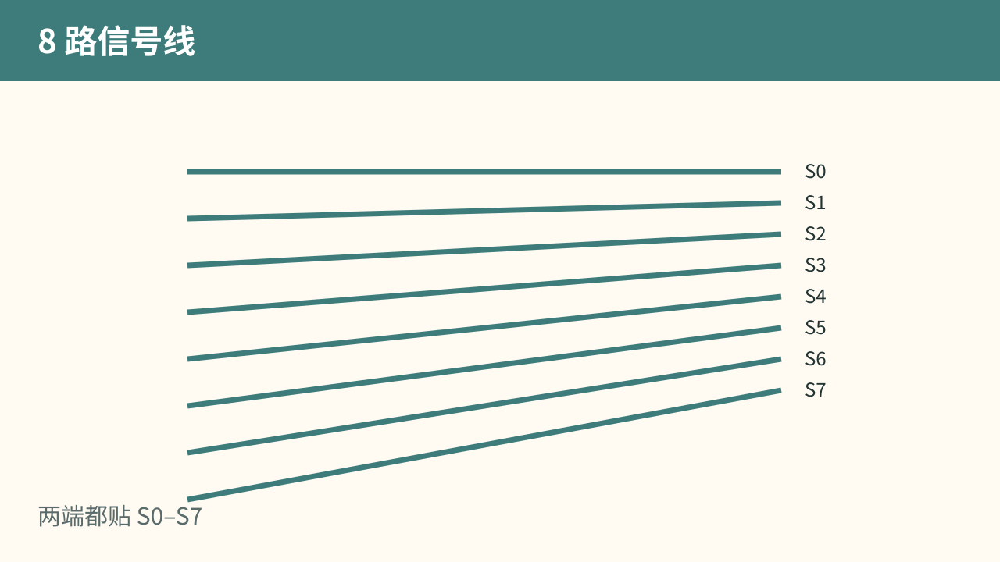

# 知识卡 · 线束编号（代号贴纸：K05-08）

> 打印建议：A5 横向 / 一页两卡对折；正面给孩子看（大字 + 图），背面给家长看（怎么问、线索记录）。

## 正面（给孩子看）

### ① 看到什么

8 根一样的线，靠标签才分得清。

### ② 先猜

不贴标签，装到后面会怎样？

- A. 一定会插错
- B. 凭颜色也能分清

<!-- 不写答案，留白。家长在背面第 ② 步准备接话。 -->

### ③ 动手验证（家里就能做，5 分钟）

1. 拿 8 支笔或 8 个玩具，分别贴 S0–S7。
2. 打乱顺序，让家人随机报一个编号。
3. 孩子在 5 秒内找出对应物品，重复 3 轮。

### ④ 它叫什么

- 外号：座位号
- 正式名：**线束编号**
- 一句话：两端同号，才不会插错。

### ⑤ 还在哪见过

- 家里：遥控器电池仓的 +/−
- 外面：网线水晶头的线序

---

## 背面（给家长看）

| 项 | 内容 |
|---|---|
| 这张卡想让孩子明白 | 编号 = 一对一；两端都贴，拆了也能装回。 |
| ② 的引导 | 先玩找编号游戏，再让孩子看真实线束的两端标签。 |
| ③ 的预期结果 | 有标签时很快找到；去掉标签后会明显变慢/找错。 |
| 适合档位 | L1 找编号 / L2 给线束贴两端 / L3 设计一套自己的编号规则 |
| 常见误解 | 容易只贴一端；拆下来就不知道另一端是谁。 |
| 延伸追问 | 1）为什么两端都要贴？ 2）插错编号会有什么现象？ 3）颜色和编号哪个更可靠？ |
| 线索记录 | 日期：＿＿＿＿ ／ 现象：＿＿＿＿ ／ 结论：＿＿＿＿ |

> 集卡规则：本卡盖 1 枚章；集满同一称号的 3 张卡，发称号「信号员」，贴纸贴在卡片右上角代号处。
