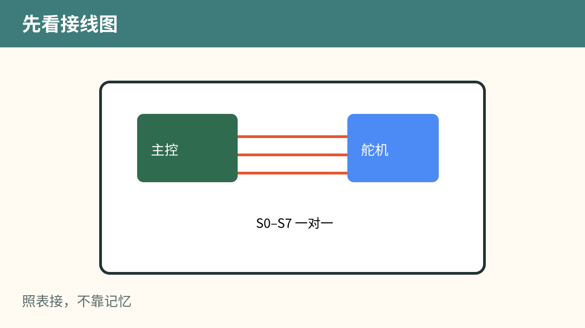
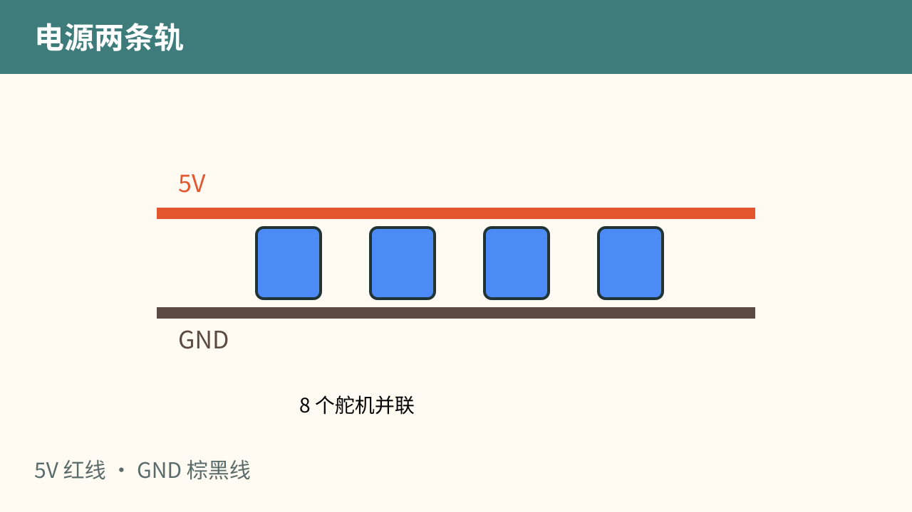
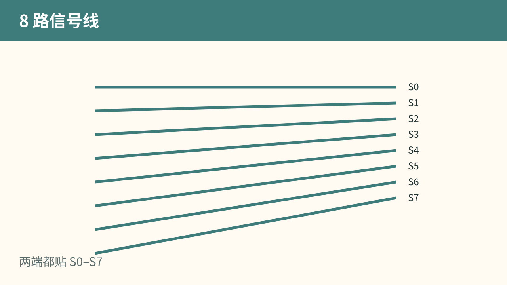
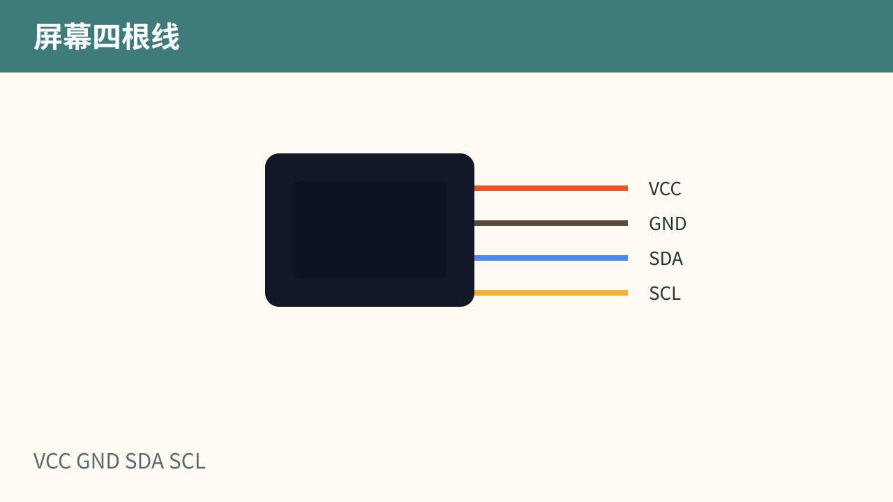
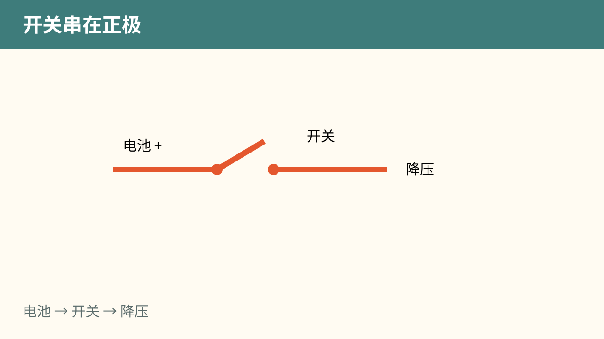
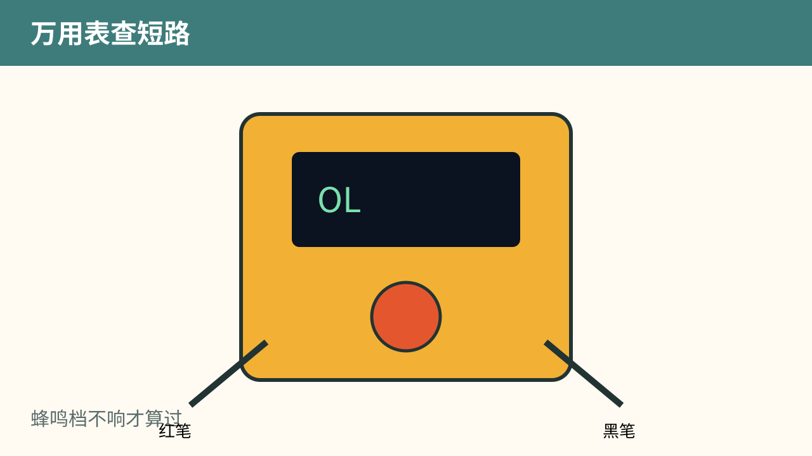

<!-- Sesame Robot 儿童课件 · 第第0课；每页含图位与讲者备注 -->

<!-- layout: title -->
# Sesame Robot · 第 3 课

今天：接线，先不送电
<!-- notes: 强调今天所有焊接和送电都由家长做，孩子只对号、记录、检查。 -->

---
<!-- layout: image -->
## 先看接线图

<!-- notes: 图和表一起看；先让孩子找到主控和 8 路舵机排针。 -->

---
<!-- layout: image -->
## 电源两条轨

<!-- notes: 红线做 5V 轨，棕黑线做 GND 轨；8 个舵机并联，不要串成一条细线。 -->

---
<!-- layout: image -->
## 8 路信号

<!-- notes: 每根线两端贴 S0–S7；插错编号是后面"腿方向反"的第一原因。 -->

---
<!-- layout: image -->
## 屏幕四根线

<!-- notes: 只记四个名字：VCC、GND、SDA、SCL；SDA/SCL 接反会不亮。 -->

---
<!-- layout: image -->
## 开关串正极

<!-- notes: 开关串在电池正极到降压之间；断开时整机断电。 -->

---
<!-- layout: big -->
## 猜一猜
为什么上电前先查短路？
<!-- notes: 让孩子先答；用"水管接错会淹"类比，不展开电路原理。 -->

---
<!-- layout: image -->
## 万用表蜂鸣档

<!-- notes: 红黑笔量 5V 轨对 GND，蜂鸣档不响才算过；响就是有焊桥或线头短路。 -->

---
<!-- layout: big -->
## 通关条件
蜂鸣档不响
<!-- notes: 家长复测一遍再签字；孩子记录测量结果。 -->

---
<!-- layout: two-col -->
### 我们发现的
- 电源和地不能碰在一起
- 每根线都有编号
### 记下的线索
- 短路 = 蜂鸣档响
<!-- notes: 收尾 3 问；预告下一课：第一次上电，只接主控和屏幕。 -->

---
<!-- layout: title -->
# 恭喜过关
你是「接线员」
<!-- notes: 发知识卡 06/07/08，提醒下一课仍由家长送电。 -->
