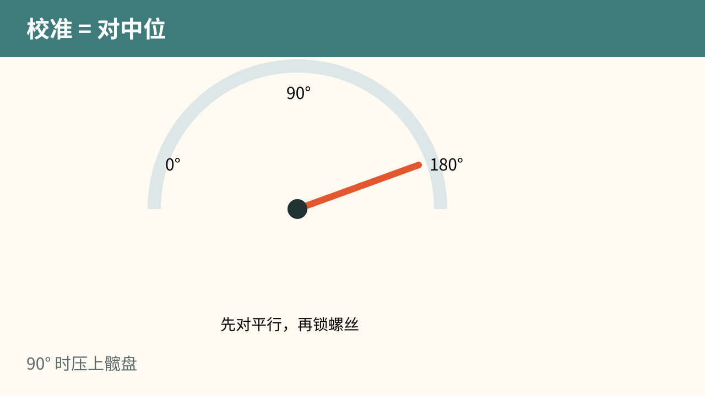

# 知识卡 · 校准与中位（代号贴纸：K05-09）

> 打印建议：A5 横向 / 一页两卡对折；正面给孩子看（大字 + 图），背面给家长看（怎么问、线索记录）。

## 正面（给孩子看）

### ① 看到什么

同一个 90°，装偏了腿就歪。

### ② 先猜

为什么要先对中位，再锁螺丝？

- A. 因为锁死后就不能再对位了
- B. 因为螺丝会自己转

<!-- 不写答案，留白。家长在背面第 ② 步准备接话。 -->

### ③ 动手验证（家里就能做，5 分钟）

1. 在纸盘上画 0、90、180 刻度，中心插一根回形针当指针。
2. 把指针转到 90°，用胶带把回形针根部固定。
3. 再试着把指针转到 180°，看胶带固定后还能不能自由转。

### ④ 它叫什么

- 外号：校秤
- 正式名：**校准**
- 一句话：先对正基准，再固定。

### ⑤ 还在哪见过

- 家里：体重秤开机归零
- 外面：机器人出厂校准

---

## 背面（给家长看）

| 项 | 内容 |
|---|---|
| 这张卡想让孩子明白 | 校准 = 让舵机的角度和结构真正对正。 |
| ② 的引导 | 先做“先固定再转”的对比实验，孩子会自己发现固定太早会卡住。 |
| ③ 的预期结果 | 胶带固定后指针不能自由转；说明固定要在对位之后。 |
| 适合档位 | L1 看刻度 / L2 对到 90° / L3 解释为什么先 REST 再锁 |
| 常见误解 | 容易急着锁螺丝；锁早了腿的角度就定死在错误位置。 |
| 延伸追问 | 1）REST 和 STAND 分别对应多少度？ 2）腿方向反了先查什么？ 3）校准后为什么还要再切两次姿态？ |
| 线索记录 | 日期：＿＿＿＿ ／ 现象：＿＿＿＿ ／ 结论：＿＿＿＿ |

> 集卡规则：本卡盖 1 枚章；集满同一称号的 3 张卡，发称号「校准师」，贴纸贴在卡片右上角代号处。
