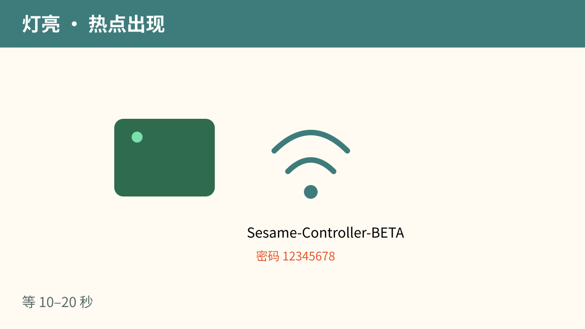

# 知识卡 · AP 热点（代号贴纸：K05-10）

> 打印建议：A5 横向 / 一页两卡对折；正面给孩子看（大字 + 图），背面给家长看（怎么问、线索记录）。

## 正面（给孩子看）

### ① 看到什么

机器人自己发出一个 WiFi 名字。

### ② 先猜

手机连上机器人热点后，为什么网页还是打不开？

- A. 手机还在用移动数据
- B. 机器人没有屏幕

<!-- 不写答案，留白。家长在背面第 ② 步准备接话。 -->

### ③ 动手验证（家里就能做，5 分钟）

1. 让家人开一个手机热点，记下名字和密码。
2. 用另一台设备连上这个热点。
3. 打开浏览器访问热点主人告诉你的地址，看能不能打开页面。

### ④ 它叫什么

- 外号：机器人自己开的 wifi
- 正式名：**AP 热点**
- 一句话：设备自己发 WiFi，别人连它。

### ⑤ 还在哪见过

- 家里：手机热点
- 外面：酒店/机场的 WiFi

---

## 背面（给家长看）

| 项 | 内容 |
|---|---|
| 这张卡想让孩子明白 | AP = 机器人当“路由器”；连上后要关移动数据。 |
| ② 的引导 | 用两台设备演示“连上但走流量”的坑；孩子最容易被这个卡住。 |
| ③ 的预期结果 | 连上热点后能打开本地页面；如果走了流量，页面会超时。 |
| 适合档位 | L1 找到热点名 / L2 连上并关数据 / L3 解释 AP 和家用 WiFi 的区别 |
| 常见误解 | 容易以为“连上 WiFi 就能上网”；机器人热点只提供本地连接。 |
| 延伸追问 | 1）热点密码在哪改？ 2）为什么 5GHz 连不上？ 3）没有路由器还能控制机器人吗？ |
| 线索记录 | 日期：＿＿＿＿ ／ 现象：＿＿＿＿ ／ 结论：＿＿＿＿ |

> 集卡规则：本卡盖 1 枚章；集满同一称号的 3 张卡，发称号「校准师」，贴纸贴在卡片右上角代号处。
