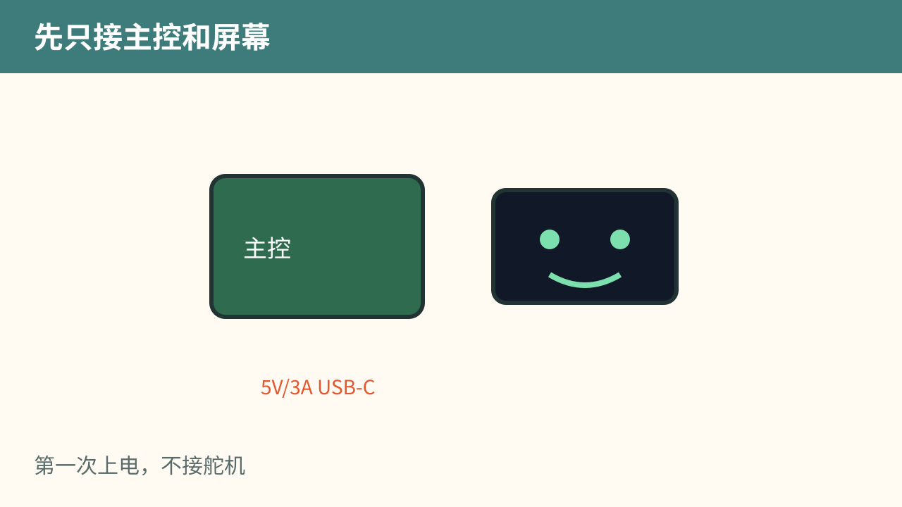
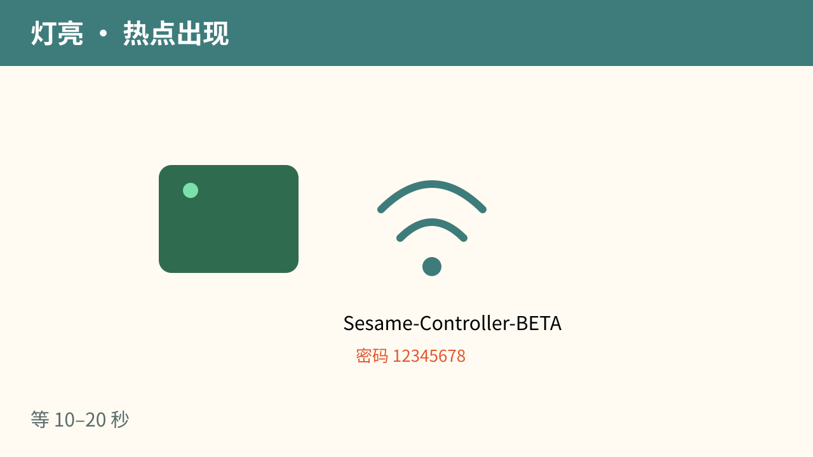
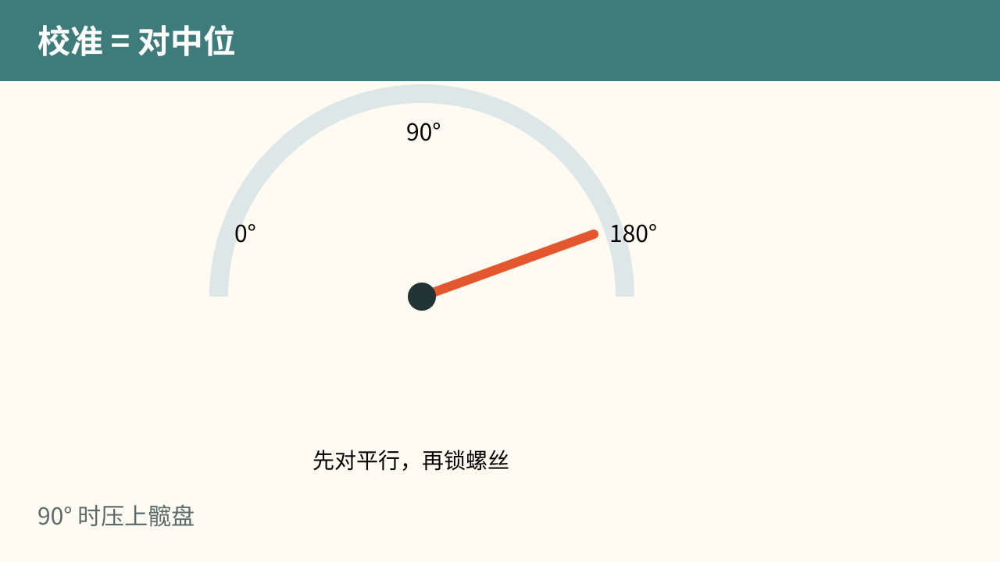
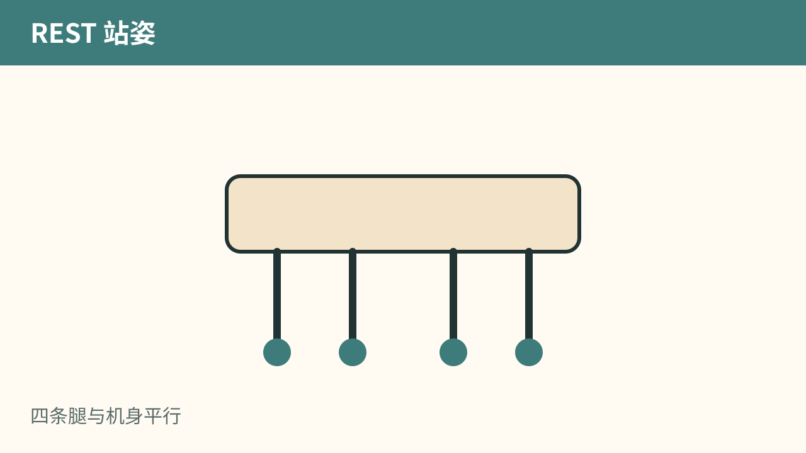
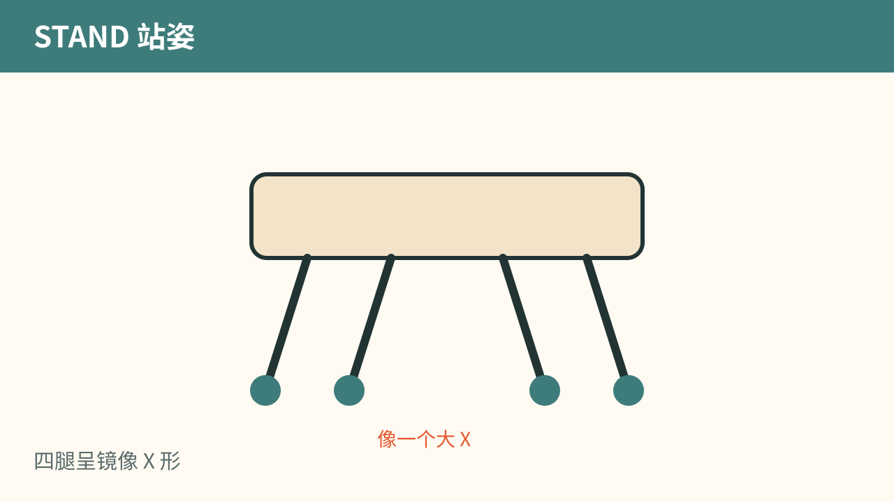
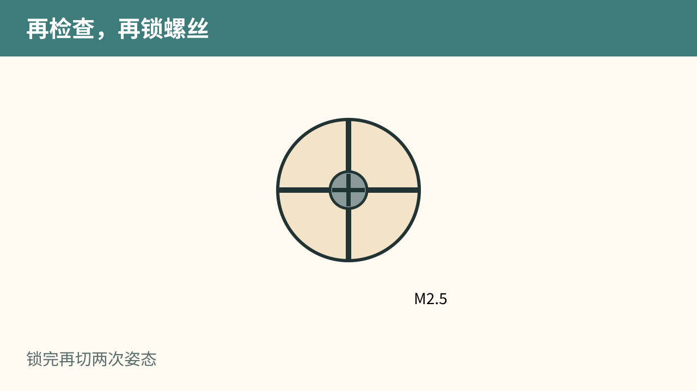

<!-- Sesame Robot 儿童课件 · 第第0课；每页含图位与讲者备注 -->

<!-- layout: title -->
# Sesame Robot · 第 4 课

今天：第一次上电，让它站好
<!-- notes: 先讲安全：手离开腿，异常立即断电；今天只接主控和屏幕做第一次上电。 -->

---
<!-- layout: image -->
## 第一次只接主控

<!-- notes: 第一次上电不接 8 个舵机，先把主控和屏幕点亮，减少变量。 -->

---
<!-- layout: image -->
## 灯亮，热点出现

<!-- notes: S2 Mini 灯亮、OLED 亮、手机搜到 Sesame-Controller-BETA；等 10–20 秒。 -->

---
<!-- layout: big -->
## 猜一猜
为什么要先校准？
<!-- notes: 让孩子先答；提示"舵机不知道自己装的盘在哪个角度"。 -->

---
<!-- layout: image -->
## 校准就是找中位

<!-- notes: 90° 时把髋盘压上轴、与机身平行；这时先不要锁螺丝。 -->

---
<!-- layout: image -->
## REST：腿和机身平行

<!-- notes: 网页点 Rest，四腿应和机身平行；这是后面所有姿态的基准。 -->

---
<!-- layout: image -->
## STAND：四条腿变 X

<!-- notes: 点 Stand，四个髋关节各转 45°，四腿呈镜像 X；左右要对称。 -->

---
<!-- layout: image -->
## 再检查，再锁螺丝

<!-- notes: 回 REST 复查，确认无干涉后再锁 M2.5 中心螺丝；锁完再切两次姿态。 -->

---
<!-- layout: big -->
## 通关条件
站 30 秒不塌
<!-- notes: 让孩子计时并观察；过关称号「调试员」。 -->

---
<!-- layout: two-col -->
### 我们发现的
- 校准前不能锁关节
- 四条腿要镜像对称
### 记下的线索
- 腿方向反，先查编号
<!-- notes: 收尾 3 问；预告下一课：让它真正走起来。 -->

---
<!-- layout: title -->
# 恭喜过关
你是「调试员」
<!-- notes: 发知识卡 09/10，提醒下一课先站再走。 -->
