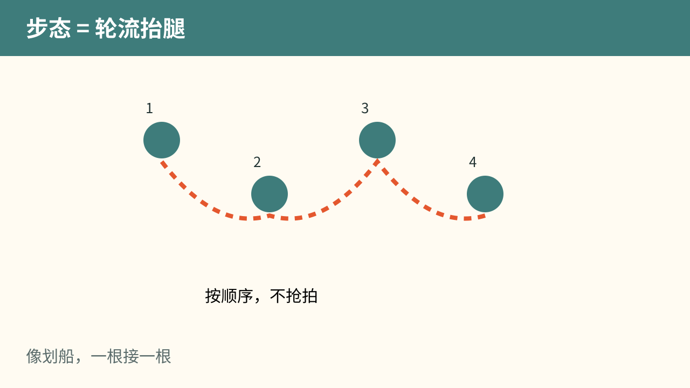

# 知识卡 · 步态（代号贴纸：K05-11）

> 打印建议：A5 横向 / 一页两卡对折；正面给孩子看（大字 + 图），背面给家长看（怎么问、线索记录）。

## 正面（给孩子看）

### ① 看到什么

四条腿不是一起蹦，而是一根接一根。

### ② 先猜

四条腿同时离地会怎样？

- A. 会摔
- B. 会跳得更高

<!-- 不写答案，留白。家长在背面第 ② 步准备接话。 -->

### ③ 动手验证（家里就能做，5 分钟）

1. 把 4 个杯子摆成正方形，代表四条腿。
2. 用手指按 1-2-3-4 的顺序，依次轻点每个杯子。
3. 再试着 4 个手指同时按下去，比较哪种更稳。

### ④ 它叫什么

- 外号：走路的舞步
- 正式名：**步态**
- 一句话：8 个舵机按顺序摆角度。

### ⑤ 还在哪见过

- 家里：人走路时手脚交替
- 外面：马走路、机器人巡检

---

## 背面（给家长看）

| 项 | 内容 |
|---|---|
| 这张卡想让孩子明白 | 步态 = 顺序 + 节奏；轮流撑地才稳。 |
| ② 的引导 | 先用手指数节奏，再看机器人；不要先讲“相位”。 |
| ③ 的预期结果 | 按顺序点时杯子不动；同时按会晃/倒。 |
| 适合档位 | L1 数节奏 / L2 换顺序 / L3 说为什么不能同时抬腿 |
| 常见误解 | 容易以为腿动得越快越稳；实际是先稳再快。 |
| 延伸追问 | 1）为什么走路会左右晃？ 2）转弯时哪条腿先动？ 3）地毯上为什么更容易摔？ |
| 线索记录 | 日期：＿＿＿＿ ／ 现象：＿＿＿＿ ／ 结论：＿＿＿＿ |

> 集卡规则：本卡盖 1 枚章；集满同一称号的 3 张卡，发称号「驾驶员」，贴纸贴在卡片右上角代号处。
