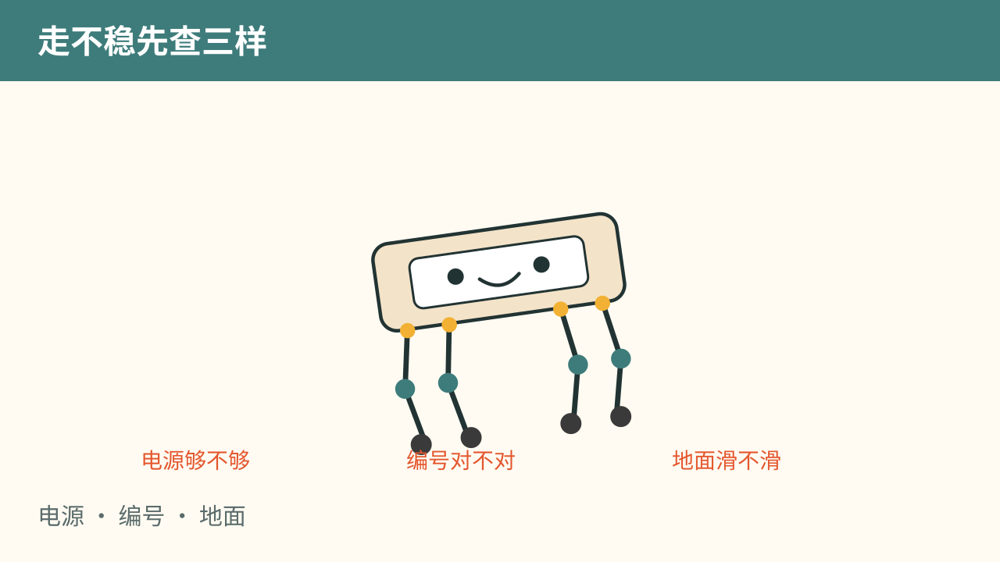

# 知识卡 · 开环控制（代号贴纸：K05-12）

> 打印建议：A5 横向 / 一页两卡对折；正面给孩子看（大字 + 图），背面给家长看（怎么问、线索记录）。

## 正面（给孩子看）

### ① 看到什么

它不知道自己有没有走到位。

### ② 先猜

闭着眼走路，能准确停在线上吗？

- A. 很难，因为没有反馈
- B. 很容易，凭感觉就行

<!-- 不写答案，留白。家长在背面第 ② 步准备接话。 -->

### ③ 动手验证（家里就能做，5 分钟）

1. 在房间地上贴一条胶带当终点。
2. 让孩子闭眼从起点走 5 步，停住。
3. 睁眼看看离终点差多少；再试一次，看能不能更准。

### ④ 它叫什么

- 外号：闭眼按菜谱做菜
- 正式名：**开环控制**
- 一句话：只按预设走，不回头检查。

### ⑤ 还在哪见过

- 家里：定时电饭煲
- 外面：老式洗衣机定时器

---

## 背面（给家长看）

| 项 | 内容 |
|---|---|
| 这张卡想让孩子明白 | 开环 = 没有反馈；地面滑/电池弱就会偏。 |
| ② 的引导 | 强调“不是它笨，是它没有眼睛和感觉”。 |
| ③ 的预期结果 | 闭眼 5 步很难正好踩线；两次落点可能不同。 |
| 适合档位 | L1 试一次 / L2 试三次记录偏差 / L3 说怎么才能“闭环” |
| 常见误解 | 容易以为程序写错了；开环本来就不能自动纠正。 |
| 延伸追问 | 1）加什么传感器能让它知道自己走到哪？ 2）为什么仿真里走得好、真机不行？ 3）人走路是开环还是闭环？ |
| 线索记录 | 日期：＿＿＿＿ ／ 现象：＿＿＿＿ ／ 结论：＿＿＿＿ |

> 集卡规则：本卡盖 1 枚章；集满同一称号的 3 张卡，发称号「驾驶员」，贴纸贴在卡片右上角代号处。
