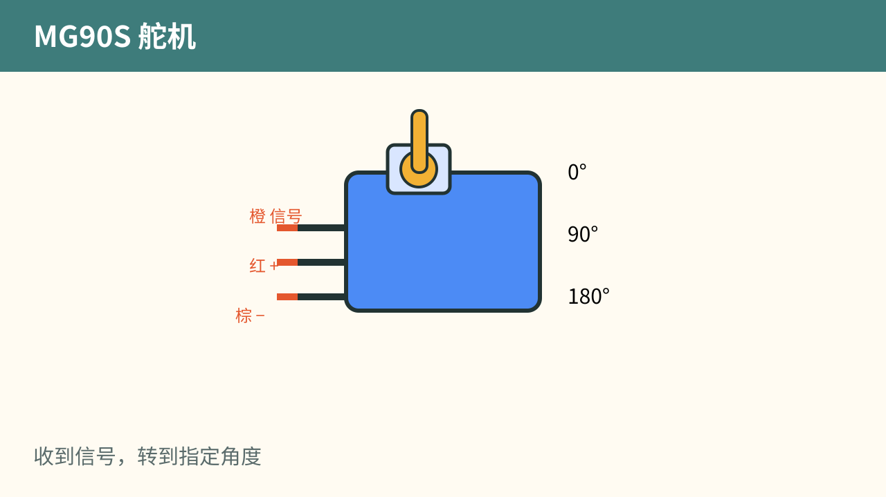

# 知识卡 · 堵转（代号贴纸：K05-13）

> 打印建议：A5 横向 / 一页两卡对折；正面给孩子看（大字 + 图），背面给家长看（怎么问、线索记录）。

## 正面（给孩子看）

### ① 看到什么

舵机被卡住还继续用力，会发烫。

### ② 先猜

腿被卡住时，舵机会不会自己停下？

- A. 不会，它会一直用力
- B. 会，它会自动关机

<!-- 不写答案，留白。家长在背面第 ② 步准备接话。 -->

### ③ 动手验证（家里就能做，5 分钟）

1. 把门开到一半，用手轻轻顶住门边，不让它关。
2. 感受门/手之间的持续用力，保持 3 秒就松开。
3. 想一想：如果一直顶住，哪里会发热？

### ④ 它叫什么

- 外号：顶住转动的电风扇
- 正式名：**堵转**
- 一句话：被卡住还继续用力，电流变大。

### ⑤ 还在哪见过

- 家里：抽屉卡住还硬推
- 外面：传送带卡料

---

## 背面（给家长看）

| 项 | 内容 |
|---|---|
| 这张卡想让孩子明白 | 堵转 = 角度到不了还使劲；会发热、耗电、伤齿轮。 |
| ② 的引导 | 只做轻顶 3 秒，不碰真实堵转的舵机；真实异常立即断电。 |
| ③ 的预期结果 | 能感到持续的对抗力；时间越长越吃力。 |
| 适合档位 | L1 感受力 / L2 说哪里会热 / L3 说遇到堵转先做什么 |
| 常见误解 | 容易以为“用力就能转过去”；实际会烧舵机/扫齿。 |
| 延伸追问 | 1）怎么判断舵机堵转了？ 2）堵转时应该先断电还是先改程序？ 3）为什么走路时腿会卡住？ |
| 线索记录 | 日期：＿＿＿＿ ／ 现象：＿＿＿＿ ／ 结论：＿＿＿＿ |

> 集卡规则：本卡盖 1 枚章；集满同一称号的 3 张卡，发称号「驾驶员」，贴纸贴在卡片右上角代号处。
