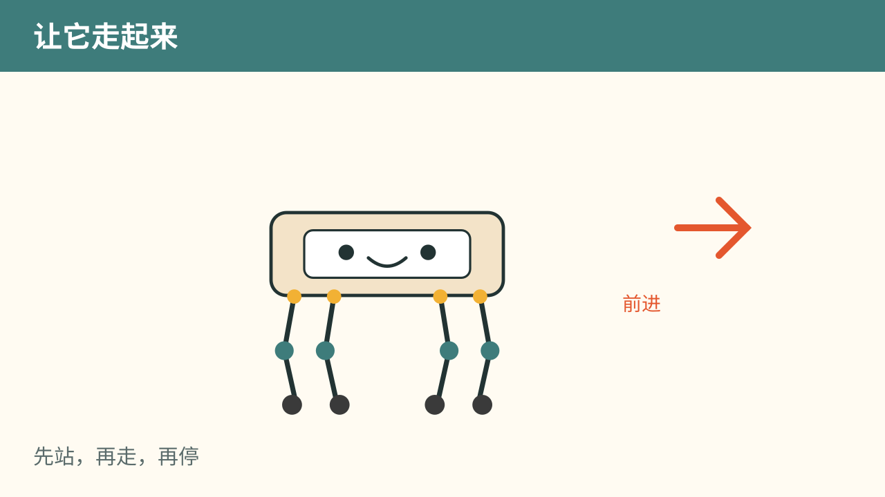
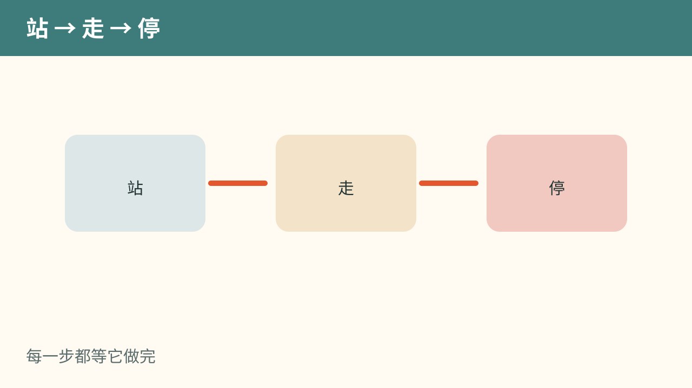
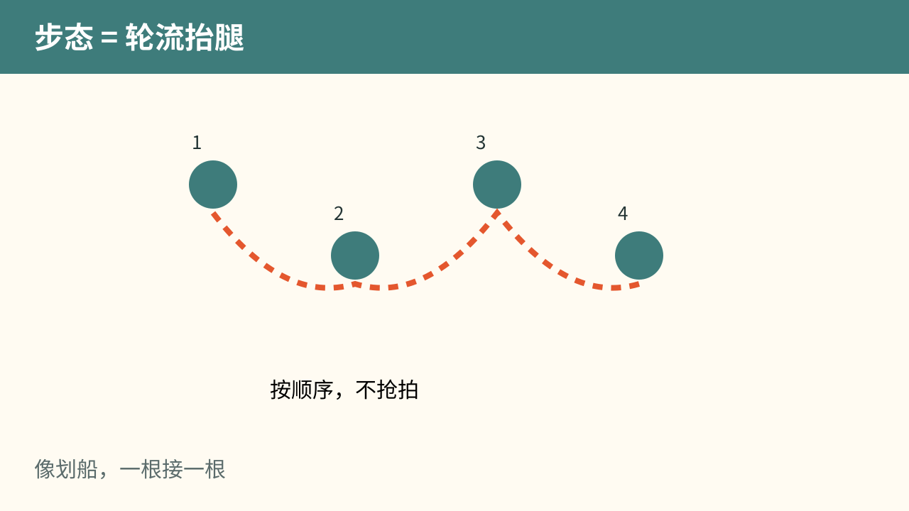
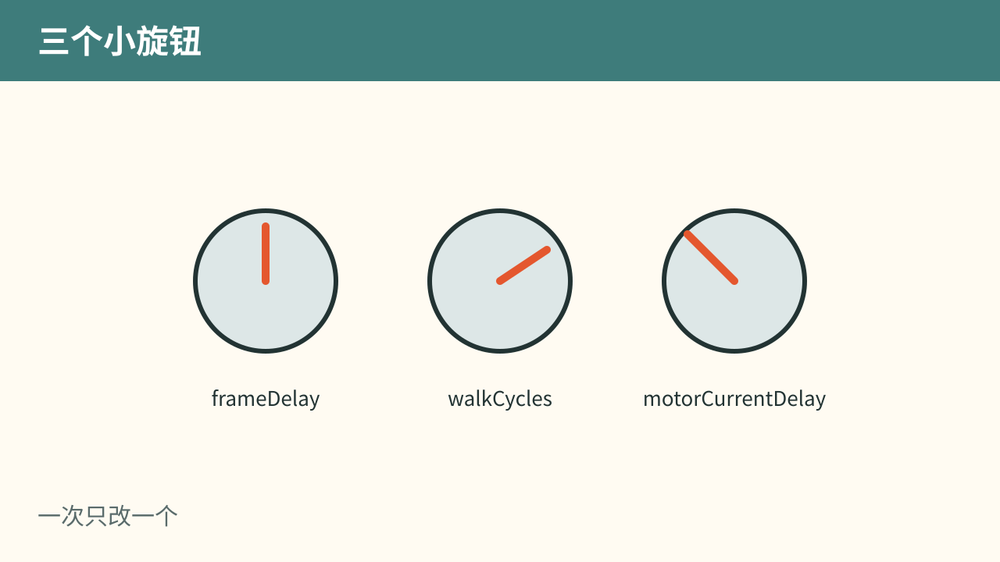
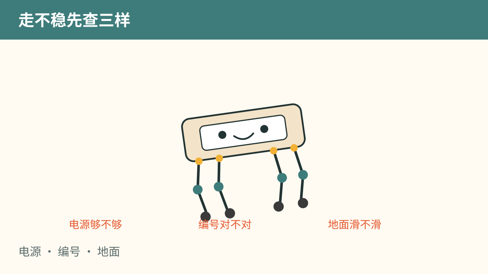

<!-- Sesame Robot 儿童课件 · 第第0课；每页含图位与讲者备注 -->

<!-- layout: title -->
# Sesame Robot · 第 5 课

今天：让它走起来
<!-- notes: 开场先复习站姿；今天只追求"连续走 10 秒不摔"，不追求快。 -->

---
<!-- layout: image -->
## 站 → 走 → 停

<!-- notes: 每次只点一个动作，等它做完再点下一个；不要连点。 -->

---
<!-- layout: big -->
## 猜一猜
它怎么迈第一步？
<!-- notes: 让孩子先猜哪条腿先动；看完再回头验证。 -->

---
<!-- layout: image -->
## 步态：轮流抬腿

<!-- notes: 8 个舵机按顺序摆角度，像划船一根接一根；不是八条腿一起蹦。 -->

---
<!-- layout: image -->
## 三个小旋钮

<!-- notes: frameDelay 管快慢，walkCycles 管步数，motorCurrentDelay 管错峰；一次只改一个。 -->

---
<!-- layout: image -->
## 先慢后快

<!-- notes: 先加大 frameDelay 让它慢慢走稳，再逐步减小；快了更容易摔。 -->

---
<!-- layout: image -->
## 走不稳先查三样

<!-- notes: 先查电源够不够、编号对不对、地面滑不滑；不要一上来改程序。 -->

---
<!-- layout: big -->
## 通关条件
连走 10 秒不摔
<!-- notes: 连续两次成功才算过；录一段 ≤10 秒视频存档。 -->

---
<!-- layout: two-col -->
### 我们发现的
- 走 = 8 个舵机排队
- 慢一点更稳
### 记下的线索
- 摔了先查电源/编号/地面
<!-- notes: 收尾 3 问；预告下一课：用一条命令让它自己动。 -->

---
<!-- layout: title -->
# 恭喜过关
你是「驾驶员」
<!-- notes: 发知识卡 11/12/13，提醒下一课带电脑或手机。 -->
