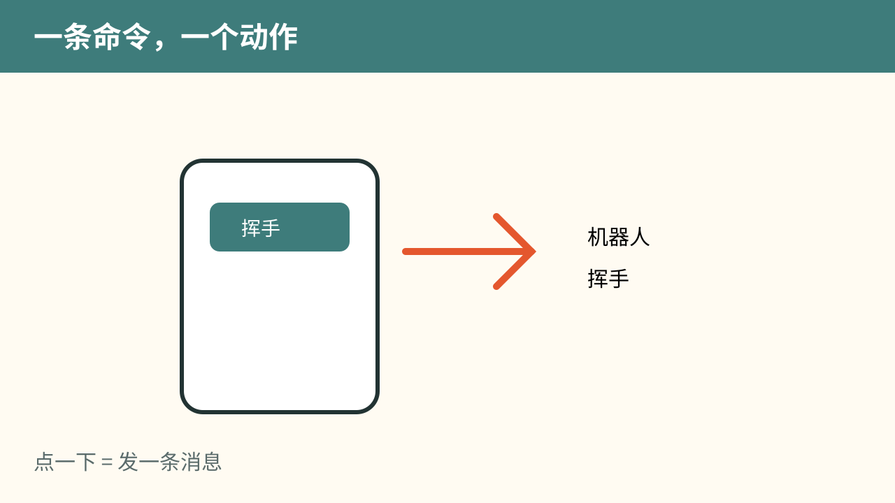

# 知识卡 · API（代号贴纸：K05-14）

> 打印建议：A5 横向 / 一页两卡对折；正面给孩子看（大字 + 图），背面给家长看（怎么问、线索记录）。

## 正面（给孩子看）

### ① 看到什么

点一下按钮，机器人就做一个动作。

### ② 先猜

按钮背后到底发了什么？

- A. 一条格式固定的消息
- B. 一根电线直接通电

<!-- 不写答案，留白。家长在背面第 ② 步准备接话。 -->

### ③ 动手验证（家里就能做，5 分钟）

1. 写一张“订单”给家人：动作=挥手，表情=开心。
2. 把订单折好，只按格式读给家人听。
3. 家人照做；再故意漏写“表情”，看结果有什么不同。

### ④ 它叫什么

- 外号：点外卖的订单
- 正式名：**API**
- 一句话：按固定格式发消息，对方照做。

### ⑤ 还在哪见过

- 家里：外卖下单、快递填单
- 外面：自动售货机按键

---

## 背面（给家长看）

| 项 | 内容 |
|---|---|
| 这张卡想让孩子明白 | API = 约定好的消息格式；格式对才执行。 |
| ② 的引导 | 用“订单”类比；让孩子当一次“机器人”，体会格式的重要性。 |
| ③ 的预期结果 | 格式完整时家人照做；漏项时结果不完整。 |
| 适合档位 | L1 读订单 / L2 写一张订单 / L3 解释“为什么格式不能错” |
| 常见误解 | 容易以为 API 是“遥控器”；它是消息，不是无线电。 |
| 延伸追问 | 1）API 的地址是什么？ 2）为什么必须用 POST？ 3）返回 status: ok 是什么意思？ |
| 线索记录 | 日期：＿＿＿＿ ／ 现象：＿＿＿＿ ／ 结论：＿＿＿＿ |

> 集卡规则：本卡盖 1 枚章；集满同一称号的 3 张卡，发称号「小工程师」，贴纸贴在卡片右上角代号处。
