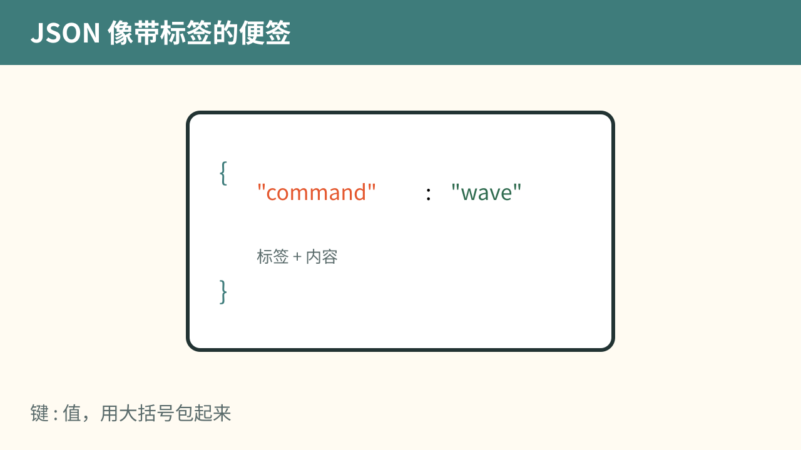

# 知识卡 · JSON（代号贴纸：K05-15）

> 打印建议：A5 横向 / 一页两卡对折；正面给孩子看（大字 + 图），背面给家长看（怎么问、线索记录）。

## 正面（给孩子看）

### ① 看到什么

大括号里写着“标签: 内容”。

### ② 先猜

为什么不用随便一句话，而要用固定格式？

- A. 固定格式不容易看错
- B. 固定格式更长

<!-- 不写答案，留白。家长在背面第 ② 步准备接话。 -->

### ③ 动手验证（家里就能做，5 分钟）

1. 准备 3 个盒子，分别贴“动作”“表情”“速度”。
2. 写 3 张便签：wave、happy、慢。
3. 把便签放进对应盒子，让家人按盒子取用。

### ④ 它叫什么

- 外号：带标签的便签
- 正式名：**JSON**
- 一句话：用大括号装“标签: 内容”。

### ⑤ 还在哪见过

- 家里：快递单上的“收件人:”
- 外面：点餐小程序的选项

---

## 背面（给家长看）

| 项 | 内容 |
|---|---|
| 这张卡想让孩子明白 | JSON = 有标签的结构化消息；机器不容易看错。 |
| ② 的引导 | 先玩分类盒子，再读 `{"command":"wave"}`；不要讲语法细节。 |
| ③ 的预期结果 | 标签和内容一一对应；放错盒子就取错。 |
| 适合档位 | L1 放便签 / L2 读一行 JSON / L3 自己写一条 command |
| 常见误解 | 容易把大括号当成“代码”；它只是包装和分组。 |
| 延伸追问 | 1）command 和 face 分别控制什么？ 2）少一个引号会怎样？ 3）JSON 和普通文字有什么区别？ |
| 线索记录 | 日期：＿＿＿＿ ／ 现象：＿＿＿＿ ／ 结论：＿＿＿＿ |

> 集卡规则：本卡盖 1 枚章；集满同一称号的 3 张卡，发称号「小工程师」，贴纸贴在卡片右上角代号处。
