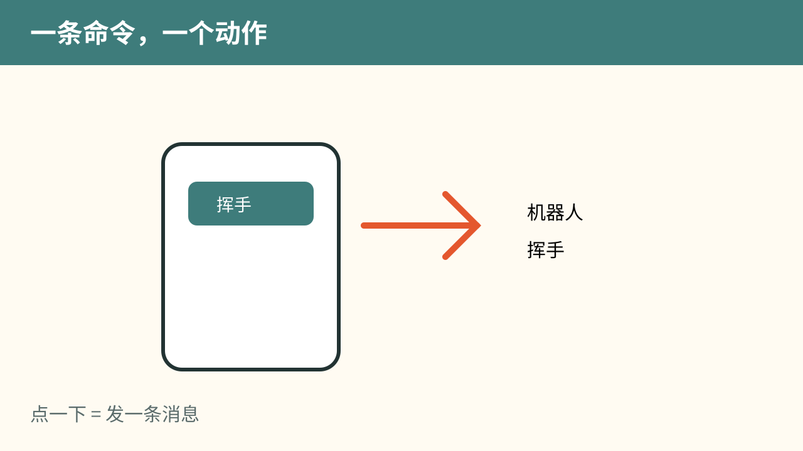
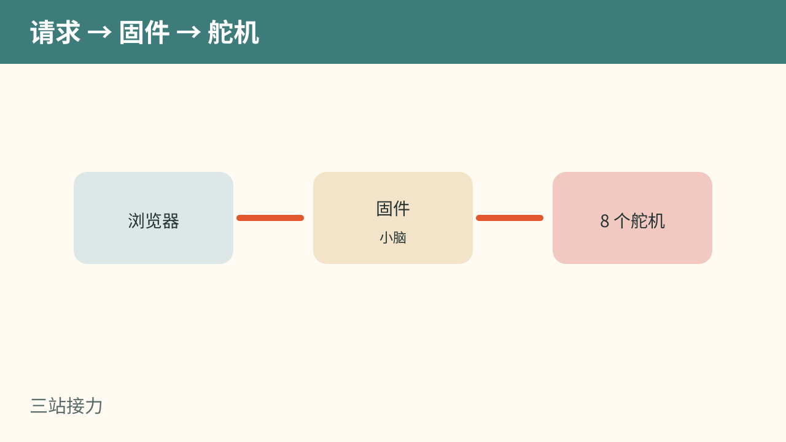
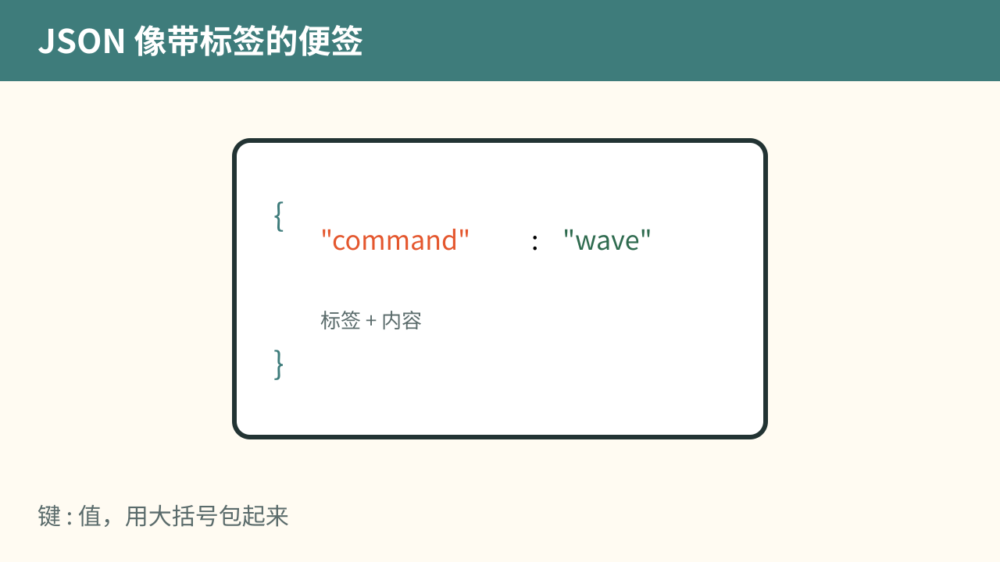
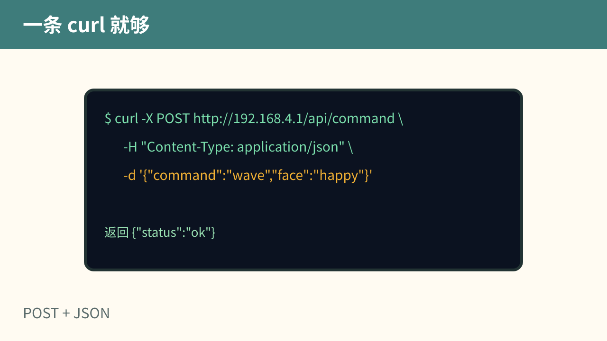
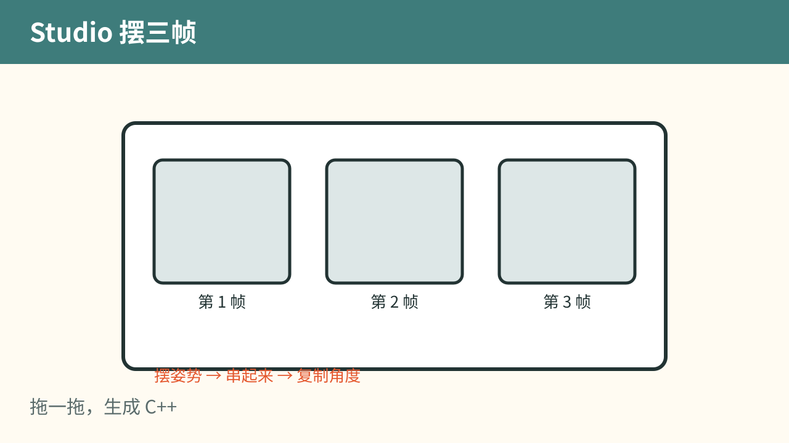
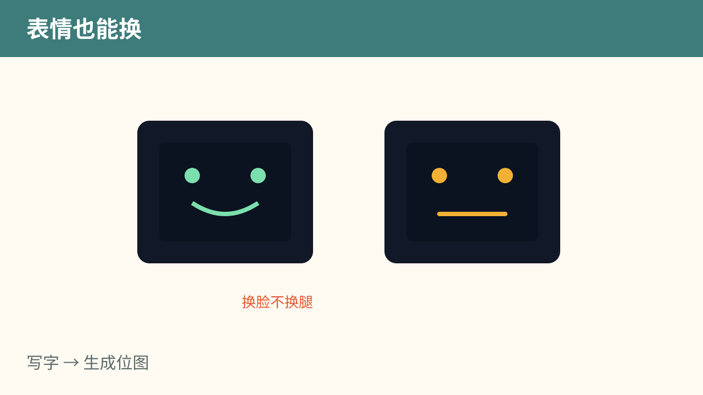

<!-- Sesame Robot 儿童课件 · 第第0课；每页含图位与讲者备注 -->

<!-- layout: title -->
# Sesame Robot · 第 6 课

今天：用一条命令让它动
<!-- notes: 开场只演示一次"点按钮 → 机器人挥手"，让孩子猜中间发生了什么。 -->

---
<!-- layout: image -->
## 点一下，动一下

<!-- notes: 网页按钮背后就是发了一条消息；今天要把这条消息看清楚。 -->

---
<!-- layout: big -->
## 猜一猜
命令怎么跑到腿上？
<!-- notes: 让孩子先画/说一条路线，再对照下一页。 -->

---
<!-- layout: image -->
## 三站接力

<!-- notes: 浏览器 → 固件 → 8 个舵机；固件是"小脑"，负责翻译命令。 -->

---
<!-- layout: image -->
## JSON 像便签

<!-- notes: 大括号里写"标签: 内容"；command 是动作，face 是表情。 -->

---
<!-- layout: image -->
## 一条 curl 就够

<!-- notes: 家长操作命令行，孩子读返回的 status: ok；不要求孩子背命令。 -->

---
<!-- layout: image -->
## Studio 摆三帧

<!-- notes: 拖关节摆姿势，串成三帧，复制生成的角度；这是"动作编辑器"。 -->

---
<!-- layout: image -->
## 表情也能换

<!-- notes: 换表情不动腿；用 image2cpp 把画变成 128×64 位图。 -->

---
<!-- layout: big -->
## 通关条件
讲清这条链路
<!-- notes: 孩子能说出"我点了什么 → 谁收到 → 谁动了"就算过。 -->

---
<!-- layout: two-col -->
### 我们发现的
- 一条命令 = 一个动作
- 固件负责翻译
### 记下的线索
- API = 给机器人的订单
<!-- notes: 收尾 3 问；预告展示：3 分钟讲自己的作品。 -->

---
<!-- layout: title -->
# 恭喜过关
你是「小工程师」
<!-- notes: 发知识卡 14/15，安排一次 3 分钟作品展示。 -->
