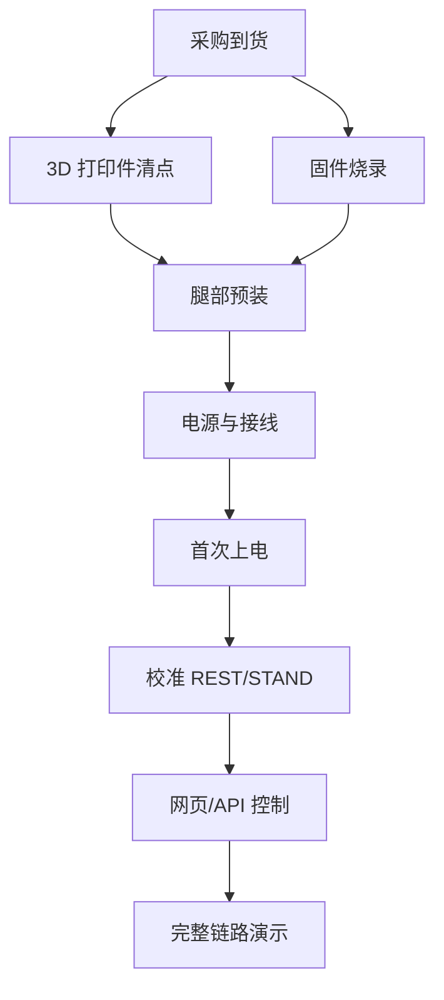

# 六维拆解总表（Sesame Robot 迷你四足机器人）

| 字段 | 值 |
|---|---|
| 适用版本 | 上游 `main` @ `f328ed3`；硬件 S2 Mini 手接线（MVP）/ Distro V3.1 |
| 最后更新 | 2026-11-05 |
| 前置条件 | 读完 `00-总纲与路线图.md` |

## 1. 六维总表

| 维度 | 是什么 / 包含什么 | 买什么（MVP 部分） | 谁做 | 门槛（最难三步） | 降级路径（可外包/买成品） | 实现路径（买成品/代做/自制 + 参数） | 卡点 |
|---|---|---|---|---|---|---|---|
| ① 硬件电子 | ESP32-S2 主控、8× MG90S、OLED、5V/3A 降压、洞洞板、开关、线束 | S2 Mini ￥45、MG90S×10 ￥150、SSD1306 ￥15、5V/3A 降压 ￥12、洞洞板 ￥6、排针 ￥5、线材 ￥35、开关 ￥3 | 家长焊接（L1 孩子点数/对号） | ① 洞洞板做 5V/GND 轨与 8 路排针；② 电源极性与降压调压；③ 8 舵机共地与走线 | 买 V3.1 成品板（￥700–1100）；或找创客空间/维修店代焊（￥100–250） | **自制 + 部分外包**：5×7cm 洞洞板，5V 轨 22AWG、信号 30AWG，降压空载调到 5.1V；接 5V/3A USB-C 充电头 | 5V 轨短路、极性反接、降压只有 1A 导致插舵机就重启 |
| ② 结构外壳 | 11 个 PLA 打印件：内部框架×1、底盖×1、顶盖×1、关节 R1–R4/L1–L4 各×1 | 代打一套 ￥100（自有打印机耗材 ￥10–20） | 家长下单/打印（L2 孩子清支撑、点数） | ① 清支撑与关键孔位公差；② 区分左右镜像件；③ 顶盖需局部支撑 | 嘉立创 3D / 淘宝代打，给 STL + PLA + 0.2mm 层高 + 2 墙 + 8–10% 填充（￥80–150） | **代做优先**：上传上游 STL，要求顶盖加支撑；收货量关键孔位能过 M2 螺丝、无翘边层裂 | 孔位偏紧硬拧滑牙、镜像件装反、顶盖压线 |
| ③ 固件 | 上游 Arduino 固件：PWM、WiFi、API、姿态序列、OLED 表情 | 无需额外硬件；只需 S2 Mini + USB-C 数据线 | 家长烧录（L1 看并复述） | ① 装 ESP32 板支持与三个库；② 选对板型/引脚表；③ 锁 `ESP32Servo v3.0.9` | 卖家代烧（￥0–50）；或买预烧录 V3.1 套件 | **用上游官方实现**：Arduino IDE 2.x，板型 LOLIN S2 Mini，`USB CDC On Boot = Enabled`，921600 上传；不要升级 ESP32Servo | 引脚表选错、串口被占用、库版本升级导致 8 舵机串扰 |
| ④ 上位机软件 | 固件内置 Web 控制页；可选 Sesame Studio、浏览器仿真器 | 无需购买；用手机/电脑浏览器 | 家长调通，L3 孩子自己发请求 | ① 连 2.4GHz 热点；② 关闭手机移动数据；③ POST JSON 格式正确 | 不装任何软件也能用：Web 页 + `curl`；仿真器免安装 | **零安装优先**：连 `Sesame-Controller-BETA`（密码 `12345678`）→ 打开 `http://192.168.4.1`；进阶用 `curl`/Python | 手机走蜂窝网络、`sesame-robot.local` 不解析、把 POST 写成 GET |
| ⑤ 算法代码 | 纯开环步态：8 个舵机按角度序列摆；步态参数 `frameDelay` / `walkCycles` / `motorCurrentDelay` | 无需购买 | 家长先跑通，L3 孩子改参数 | ① 理解"角度序列 = 步态"；② 校准中位；③ 调参消除重启/打滑 | 不写代码也能做：用 Web 页预设动作 + 改设置；Sesame Studio 可视化编排 | **先用预设再创作**：先用 `forward/stand/wave`，再用 Studio 摆 3 帧生成 C++；算法升级（RL）属于长期选修 | 开环无反馈走不稳、参数改太猛导致堵转、软地面打滑 |
| ⑥ 资料与生态 | 上游 GitHub、build/wiring guide、Studio、仿真器、Companion App、ML 工具 | 无 | 家长查资料，孩子看演示 | ① 找对版本与 commit；② 分辨官方与社区项目；③ 遵守 Apache-2.0 | 全部可在线获取；不依赖付费课程 | **锁定 commit** `f328ed35f5cbcbdd44a5e16e3ec679d2caa00d92`；本地不复制上游大文件，只记入口与改动 | 上游更新后引脚/接口变化、社区链接失效、把旧 V1/V2 当新板买 |

> 采购明细与参考价见 `05-安全与工具采购清单.md`；工程参数以 `projects/sesame-robot/docs/` 为准。

## 2. 依赖关系

关键路径：**打印件到货 → 腿部预装 → 洞洞板电源与接线 → 校准**。最长的是打印（2–7 天）与校准（最容易反复），固件烧录通常 30 分钟内能完成。先发打印、同时烧固件，能省一半日历时间。

## 3. 家长技能矩阵（本项目实际需要）

| 技能 | 本项目是否需要 | 用在哪一步 | 零基础替代方案 |
|---|---|---|---|
| 焊接 | **需要**（MVP 手接线方案） | 洞洞板电源轨、8 路排针、OLED 四线、开关 | 找创客空间/维修店代焊（￥100–250）；或买 V3.1 成品板（免焊） |
| 烧录固件 | **需要** | Arduino IDE 上传主固件与电机测试固件 | 卖家代烧；或买预烧录 V3.1 套件 |
| 命令行 | 可选 | 用 `curl` 测 API、跑 `check_env.sh` | 全程用 Web 控制页，不碰命令行 |
| 3D 打印 | 不必须 | 11 个结构件 | 代打（￥80–150），只需上传 STL |
| 金属加工 | 不需要 | — | — |
| 调试排错 | **必须**（无法外包） | 全程 | 按 `04-验收与展示.md` 的排查顺序做 |

## 4. Top 卡点清单（提前预防）

| # | 卡点 | 现象 | 预防手段 | 出现后先查什么 |
|---|---|---|---|---|
| 1 | 5V 跌压导致重启 | 插上一个舵机就重启、走两步就断 | 用 5V/3A 以上电源；保留 `motorCurrentDelay` 默认 20ms；先空载测舵机 | 万用表量 5V 轨带载电压 → 换电源 → 调大延迟 |
| 2 | 舵机中位/方向没校准 | 走路抽筋、原地打转、腿呈内八 | 先跑电机测试固件；`REST` 装髋盘、`STAND` 看镜像 X；确认再锁 M2.5 螺丝 | 查 S0–S7 编号是否插错 → 查左右腿镜像 → 再怀疑固件 |
| 3 | 打印件公差/镜像件 | 装不进、合不上盖、左右腿一样 | 下单时要求清支撑；先干装；镜像件贴 L/R 标签 | 清支撑 → 轻回牙 → 核对镜像件与装配图 |
| 4 | 手机连不上控制页 | 网页打不开或按钮无反应 | 关闭手机移动数据；只连 2.4GHz；直接输 `192.168.4.1` | 看串口日志 IP → 换浏览器 → 关 AP 隔离 |
| 5 | 库版本升级 | 动一个舵机带动好几个 | 锁 `ESP32Servo v3.0.9`，不点"全部升级" | 库管理器卸载高版本，重装 3.0.9 |

## 5. 与工程文档的对应关系

| 本手册章节 | 对应工程文档 |
|---|---|
| ① 硬件电子 | `projects/sesame-robot/hardware/` |
| ② 结构外壳 | `projects/sesame-robot/enclosure/` |
| ③ 固件 | `projects/sesame-robot/firmware/` |
| ④ 上位机软件 | `projects/sesame-robot/software/` |
| ⑤ 算法代码 | `projects/sesame-robot/code/` |
| ⑥ 资料与生态 | `projects/sesame-robot/docs/99-参考资源.md` |
