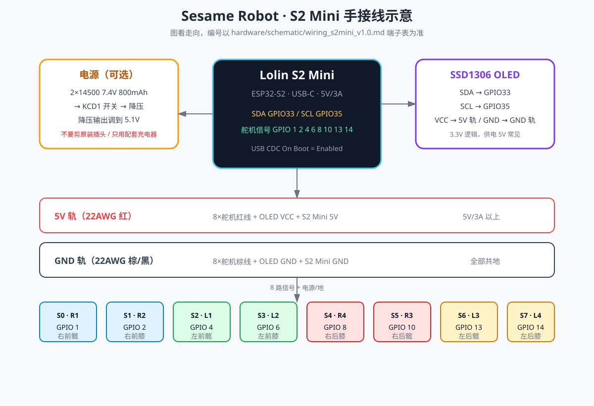

# S2 Mini 手接线表（v1.0）

> 适用版本：上游 `f328ed3` + Lolin S2 Mini　|　最后更新：2026-11-05　|　前置条件：已读完 `docs/03-组装与调试.md`

## 1. 舵机信号

| 编号 | 腿 | GPIO | 线色（信号） | 对端 | 备注 |
|---|---|---|---|---|---|
| Motor 0 | R1 | 1 | 橙 | 洞洞板 S0 | 右前髋 |
| Motor 1 | R2 | 2 | 橙 | 洞洞板 S1 | 右前膝 |
| Motor 2 | L1 | 4 | 橙 | 洞洞板 S2 | 左前髋 |
| Motor 3 | L2 | 6 | 橙 | 洞洞板 S3 | 左前膝 |
| Motor 4 | R4 | 8 | 橙 | 洞洞板 S4 | 右后膝 |
| Motor 5 | R3 | 10 | 橙 | 洞洞板 S5 | 右后髋 |
| Motor 6 | L3 | 13 | 橙 | 洞洞板 S6 | 左后髋 |
| Motor 7 | L4 | 14 | 橙 | 洞洞板 S7 | 左后膝 |

> 编号来自上游固件 `servoPins`（S2 Mini 配置）。插错口是最常见的“方向反/乱动”原因，先查编号再查固件。

## 2. 电源与 I2C

| 端子 | 信号 | 线色 | 对端 | 备注 |
|---|---|---|---|---|
| 5V 轨 | 5V | 红 | 8×舵机红线 + OLED VCC + S2 Mini 5V | 5V/3A 以上 |
| GND 轨 | GND | 棕/黑 | 8×舵机棕线 + OLED GND + S2 Mini GND | 全部共地 |
| SDA | GPIO33 | 蓝/绿 | OLED SDA | 硬件 I2C |
| SCL | GPIO35 | 黄/白 | OLED SCL | 硬件 I2C |
| 开关 | 电池正极 | 红 | 电池 + → 开关 → 降压输入 + | 开关串正极 |
| 降压输出 | 5V | 红 | 5V 轨 | 空载调到 5.1V |

## 3. 舵机线序

MG90S 常见线色：

| 线色 | 含义 | 接法 |
|---|---|---|
| 棕/黑 | GND | GND 轨 |
| 红 | VCC | 5V 轨 |
| 橙/黄/白 | 信号 | 对应 GPIO / S0–S7 |

> 不同批次线色可能不同，**以舵机标签/卖家说明为准**；上电前用万用表确认红/棕极性与 5V 轨一致。

## 4. V3.1 成品板差异

| 项 | S2 Mini 手接线 | V3.1 板 |
|---|---|---|
| 主控 | ESP32-S2 | ESP32-S3 |
| 舵机信号 | GPIO 1/2/4/6/8/10/13/14 | GPIO 4/5/6/7/10/11/12/13 |
| I2C | SDA 33 / SCL 35 | SDA 8 / SCL 9 |
| 供电 | USB-C PD 5V/3A 或电池 + 降压 | USB-C PD 12V 或 14500 电池 |
| 固件 | 自己烧 | 套件通常预烧录 |
| 注意 | 线束多、易短路 | 买 V3.1，不要 V2；贴片件不建议手焊 |

## 5. 上电前检查

1. 万用表通断档：5V 轨对 GND **不响**。
2. 目检：无焊桥、无散线、无裸线可能碰到排针。
3. 只接 USB，不接电池；确认 S2 Mini 灯亮、OLED 亮。
4. 串口 115200 有启动日志；再逐个插舵机。
5. 插舵机时手离开腿，异常异响/发烫立即断电。

## 6. 上游参考

- 接线指南：https://github.com/dorianborian/sesame-robot/blob/main/docs/wiring-guide/README.md
- 固件引脚表：https://github.com/dorianborian/sesame-robot/blob/main/firmware/README.md
- PCB 说明：https://github.com/dorianborian/sesame-robot/blob/main/hardware/pcb/README.md
